# Reusable Finite State Machine

---

## A simple Finite State Machine (FSM) implementation that you can reuse for your own needs.

---

This library is both hosted as a [nuget package](https://www.nuget.org/packages/ReusableFiniteStateMachine.Release) and as [open source](https://github.com/elTRexx/ReusableFiniteStateMachine).

---

### Context

#### Origin :

As I was exploring Godot game engine, I wanted to create a simple POC game, and quickly ends up using built in Godot FSM for animation. But I then prefered to use my own implentation, abtract enough to be reusable. 
As a simple and small project, it became naturally a good candidate for me to learn and explore the new testing framwork [TUnit](https://github.com/thomhurst/TUnit) developped by Tom Longhurst, whose main "selling" point from well known framework like [xUnit](https://github.com/xunit/) is to rely on source code generation underneath instead of code reflexivity with the promise to be more performant.

---

#### Developing journey :

Being aware that software testing is a precious skill for a computer scientist that I was lacking of, I seized the opportunity of a new and promissing testing framework being released, [TUnit](https://github.com/thomhurst/TUnit), to fill this gap. A project I just created was the perfect candidate at it is a small and simple one to aquire this testing mindset.

I began by implementing my solution and testing it like I'm used to do before with a side console application testing project. 
That assured me that my FSM library was stable enough to then be focused only on exploring and learning software (Unit - Integration - Fonctionnal - End To End) testing "phylosophy" while also learning the concrete implementation of the new promissing testing framework [TUnit](https://github.com/thomhurst/TUnit).

I used to read/watch several tutorial on software testing being framework agnostic or not. (mainly referenced as Unit testing though they usually also explore integration testing).

For [TUnit](https://github.com/thomhurst/TUnit) itself, as a new framework, there is very few external ressource to learn it. But its main developer, Tom longhusrt, id doing a very good job [documenting his solution](https://tunit.dev/) and he was also helping me directly on his github repository to answer my questions.

The main issue I had with [TUnit](https://github.com/thomhurst/TUnit) was that I'm using Visual Studio 2022 and being restricted at using .Net 9.0 and C# 14 in preview mode. Some older versions of [TUnit](https://github.com/thomhurst/TUnit) was working while newer one not. The issue revolved around building toolchain and package versions conflicts. I do not use Visual Studio 2026, but I supose the up-to-date building toolchain might have resolved the issue. You can read my invistigation [here](https://github.com/thomhurst/TUnit/discussions/5248) if you are curious.

Except that itchy specific issue, learning unit testing was pretty smooth, both in using [TUnit](https://github.com/thomhurst/TUnit) and embrassing more and more the "art" of testing.

---

#### Axes of improvements :

- The simulated test game player FSM revolve on using a static class hodling 'inner game state' acting kind of like global properties (bad practice).

- For end to end testing I'm using a batch of N repeated 30 seconds timed out test, might not be optimal way for end to end testing.

- Using a `Dictionary<IStateMachine,Dictionary<Type,IState>` as a cache that also describe the ownership relationship of `IState` states owned by each `IStateMachine` FSM might not be the cleanest choice.

- Having some methods being virtual merely only for testing purpose (taking advantage of mocking verification) might not worth the overhead.

- Likewise, architecturally offering the cache to be specialized for testing purpose might not worth it.

- Still have to explore code coverage and overcome some difficulties inherent to TUnit and my Visual Studio 2022 community edition (not buit-in support for code coverage in VS 2022 CE IDE and using [Fine Code Coverage](https://github.com/FortuneN/FineCodeCoverage) extension seems to [not be entirely adapted](https://github.com/FortuneN/FineCodeCoverage/blob/master/README.md#prerequisites) for TUnit yet.)

---

#### Testing :

My main personnal purpose of this library is to improve my testing skills.

For that I choose to use new [TUnit](https://github.com/thomhurst/TUnit) testing framework to take advantage of this discovering mindset process of both a paradigm and a backend framework supporting it.
Experimented as both an advantage and a drawback of it, was to be confronted of some bugs of [TUnit](https://github.com/thomhurst/TUnit) while using it. 
Those are expected consequences of any a new and WIP framework like [TUnit](https://github.com/thomhurst/TUnit) is. 
The advantage was to better understanding how the inner mechanisms of such a testing framework work, and I would like to emphasis that the person behind [TUnit](https://github.com/thomhurst/TUnit) was of great help when I needed some.
The drawback was more time consuming and being then less effective for learning only.
The main disadvantage of my choice to explore [TUnit](https://github.com/thomhurst/TUnit) here is to be less familliar with more commonlly used testing framework like [xUnit](https://github.com/xunit/xunit), [NUnit](https://github.com/nunit/nunit) and [MSTest](https://github.com/microsoft/testfx).
This can be debattable of course, but I consider having a good proportion for adaptation and being able to transfer learned skills to other practical implemetations. 
So I consider that disadvantage less proeminent for me.

---

### Description

This library is articulated around 5 main parts :

- States with a base abstract class from which to derive all others concrete used ones with per-state life cycle (Enter -> Update -> Exit)

- Finite State Machine (FSM) that drive the flow of states to transition from and into along a centralized or decentralized paradigm (prioritizing decentralized one)

- Factories to encapsulate states and state machines objects creation

- Caching of such created states and state machines

- Services that assure the configuration and building of the .Net built-in Dependency Injection framework as well as offering static access to usefull services (factories, cache and optionally all registered services)

---

#### Class diagram

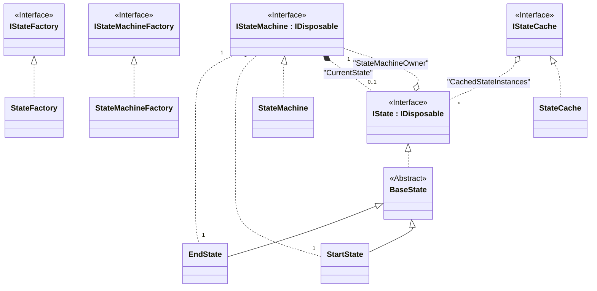

---

#### Finite State Machine (FSM)

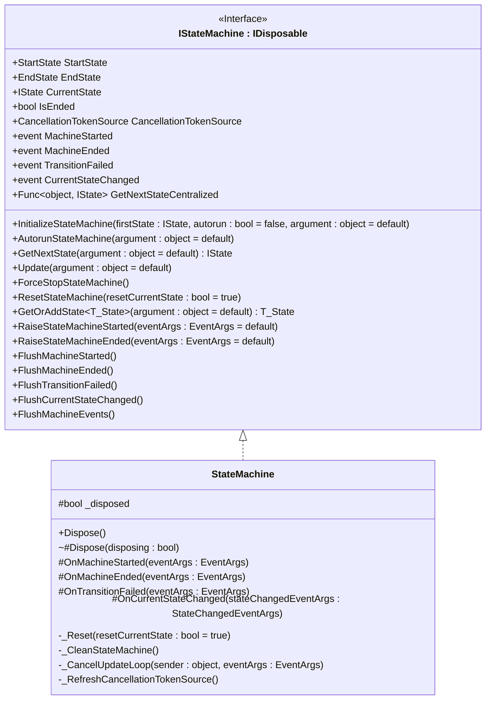

You can use the built-in FSM implementation of this library by using `StateMachineFactory.CreateStateMachine()` factory method that will simply return a new `StateMachine` object.

Or you can create your own specialized class implementation by deriving from `StateMachine` class. (see [FSM creation](#creation))

This class drive the FSM lifecycle by managing its state's flow via transition rules from states to states either centralized in one place or decentralized in each states (or even a mix of both paradigms). 
Each main steps of the FSM can be responded via an event driven approch.

There is 4 main lifecycle step and corresponding events :

- `MachineStarted` when the FSM just started

- `MachineEnded` when the FSM just ended

- `TransitionFailed` when a state transition of a running FSM failed

- `CurrentStateChanged` when the FSM just transitionned away from a given state to a different one.

The `IStateMachine` interface expose thoses

- Properties
  
  - `StartState`
  
  - `EndState`
  
  - `CurrentState`
  
  - `IsEnded`
  
  - `CancellationTokenSource`
  
  - `GetNextStateCentralized`

- Methods :
  
  - `InitializeStateMachine(IState, bool, object?)`
  
  - `AutorunStateMachine(object?)`
  
  - `GetNextState(object?)`
  
  - `Update(object?)`
  
  - `ForceStopStateMachine()`
  
  - `ResetStateMachine(bool)`
  
  - `GetOrAddState<T_State>(object?)`
  
  - `RaiseStateMachineStarted(EventArgs?)`
  
  - `RaiseStateMachineEnded(EventArgs?)`
  
  - `FlushMachineStarted()`
  
  - `FlushMachineEnded()`
  
  - `FlushTransitionFailed()`
  
  - `FlushCurrentStateChanged()`
  
  - `FlushMachineEvents()`
  
  - `Dispose()`

- Events
  
  - `MachineStarted`
  
  - `MachineEnded`
  
  - `TransitionFailed`
  
  - `CurrentStateChanged`

##### Properties

###### `StartState`

The `StartState` object instance for this FSM (one for each FSM instances)

###### `EndState`

The `EndState` object instance for this FSM (one for each FSM instances)

###### `CurrentState`

The `IState` implementing object instance that is the current active state of this FSM

Changing this property value to a different `IState` will automatically call `OnExit()` on the state to transition away and `OnEnter()` on the state to transition into. It also raise `OnCurrentStateChanged` event.

###### `IsEnded`

Checking if this FSM `CurrentState` is equal to this FSM `EndState` meaning this FSM is not running

###### `CancellationTokenSource`

###### `GetNextStateCentralized`

The delegate method that will encapsulate all centralized transition logic that fallback to be called whenever decentralized transition logic of the `CurrentState` return a `null` value.

##### Methods

###### `InitializeStateMachine(IState, bool, object?)`

Initializing this FSM with the first state to transition into from its `StartState` and either automaticcaly start running it or not (default is not). You can also pass additional argument(s) in case you need them for your FSM initialization.

###### `AutorunStateMachine(object?)`

Create a asynchronous`Task` that run this FSM via a looping `Update` calls until its `CancellationTokenSource` is cancelled.

###### `GetNextState(object?)`

Gettting the next logical `IState` of this FSM `CurrentState`, either decentralized (prioritized) or centralized via its `GetNextStateCentralized` delegate callback.

###### `Update(object?)`

Updating this FSM by getting the next logical state to transition into and calling this potential new state own `Update(object?)` method.

###### `ForceStopStateMachine()`

Manually cancel the FSM `CancellationTokenSource` to force stoping it.

###### `ResetStateMachine(bool)`

Reset this FSM to its initial 'inner state' (fields and properties) to their default values, with the extra option to avoid resetting its current state (by default it is resetted too).

###### `GetOrAddState<T_State>(object?)`

Get directly return the owned state of type `T_State` is already registered under this state machine in the `IStateFactory.CachedStateInstances` cache or create a new one, register it under this state machine as its owner in that cache and return it.

###### `RaiseStateMachineStarted(EventArgs?)`

Raise associated `MachineStarted` event with any potential given `EventArgs` arguments.

###### `RaiseStateMachineEnded(EventArgs?)`

Raise associated `MachineEnded` event with any potential given `EventArgs` arguments.

###### `FlushMachineStarted()`

Flush this FSM `MachineStarted` event of all potential remaining registered handler(s) to it.

###### `FlushMachineEnded()`

Flush this FSM `MachineEnded` event of all potential remaining registered handler(s) to it.

###### `FlushTransitionFailed()`

Flush this FSM `TransitionFailed` event of all potential remaining registered handler(s) to it.

###### `FlushCurrentStateChanged()`

Flush this FSM `CurrentStateChanged` event of all potential remaining registered handler(s) to it.

###### `FlushMachineEvents()`

Flush all events of this FSM by calling the 4 above methods.

###### `Dispose()`

Dispose this FSM in order to clean the `IStateFactory.CachedStateInstances` cache from the `IState` it owns.

##### Events

###### `MachineStarted`

Event raised everytime this FSM `StartState` execute its `OnEnter(object?)` method. Usually automaticaly called whenever this FSM `CurrentState` is transitionning into its `StartState` state.

###### `MachineEnded`

Event raised everytime this FSM `EndState` execute its `OnEnter(object?)` method. Usually automaticaly called whenever this FSM `CurrentState` is transitionning into its `EndState` state.

###### `TransitionFailed`

Event raised whenever this FSM `Update(object?)` method fail to get a non NULL next state from its `GetNextState(object?)` method call.

###### `CurrentStateChanged`

Event raised everytime this FSM `CurrentState` is set to another different `IState`. 
So setting it to the same value doesn't raise this event.

---

#### States

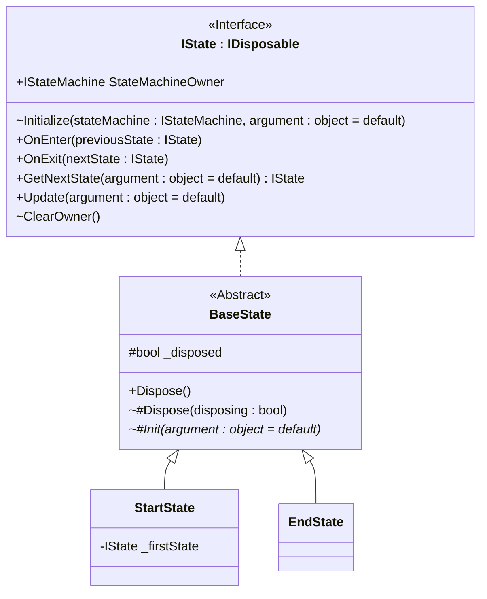

Inside your project create as many state class as you need, all of them should derive from `ReusableFiniteStateMachine.Sources.States.Interfaces.BaseState` abstract class.

Then you'll need to implement for each of your own state class thoses methods :

- `Init(object?)`
- `OnEnter(IState?)`
- `OnExit(IState?)`
- `Update(object?)`
- `GetNextState(object?)`
- Optionally `Dispose(bool)` overridable overload

##### `Init(object?)`

In this method you can add your own logic to initialize your own state objects. This method is automatically called when a new `ReusableFiniteStateMachine.Sources.States.Interfaces.IState` object is created via `ReusableFiniteStateMachine.Sources.Factories.Interfaces.IStateFactory.GetOrCreateState<T_State>(IStateMachine stateMachine, object?)` factory method.

##### `OnEnter(IState?)`

In this method you can add your own logic to be executed each time the FSM transition into this state of yours.

##### `OnExit(IState?)`

In this method you can add your own logic to be executed each time the FSM transition away from this state of yours.

##### `Update(object?)`

In this method you can add your own logic to be executed each time the FSM update itself if this state of yours is the current state of this FSM.

##### `GetNextState(object?)`

In this method you can add you transition logic to code to which other `ReusableFiniteStateMachine.Sources.States.Interfaces.BaseState` to transition into from this state of yours. Doing that this way, you are them embrassing a decentralized transition mechanism for the FSM that driving this state of yours.

##### `Dispose(bool)`

Optionally you may override the virtual `BaseState.Dispose(bool)` *(that is automatically called by `IDisposable.Dispose()` implementation with `true` as its `disposing` argument)* if you want to add extra ressources disposing logic when your are disposing your own `IState` state.
The default implementation is calling `IStateFactory.CleanCache(IState)` method with itself (this) as its state argument to properly remove it from the `IStateFactory.CachedStateInstances` cache first.

---

#### Factories

`IStateMachineFacory` and `IStateFacotry` factories classes externalize and decouple the process of creating new objects in one place, following the factory design pattern.

##### Finite State Machine factory

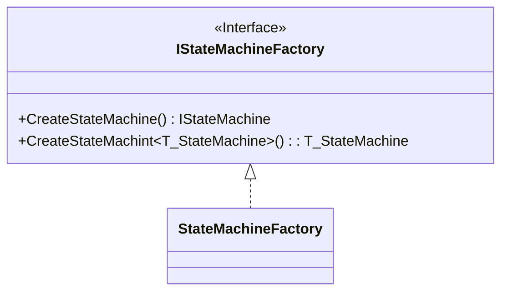

This factory class simply return a new `StateMachine` instance, or any given other implementing `IStateMachine` concrete class you might use instead.

---

##### State factory

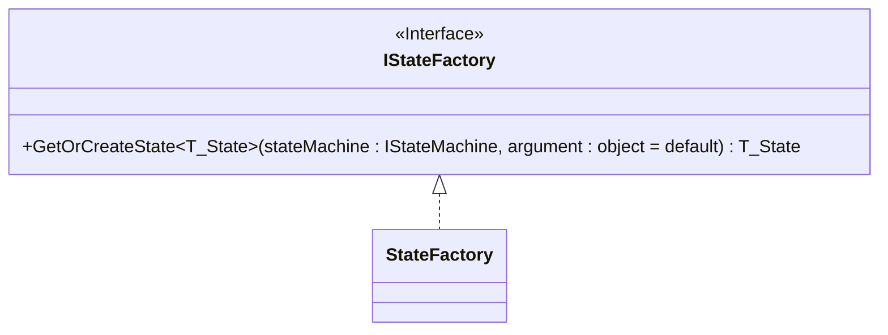

This factory is a little more elaborate with its exposed
`GetOrCreateState<T_State>(IStateMachine, object?)` method that :

1. Create a new given generic type that implement `IState` object.

2. Initialize it with its `IStateMachine` that will own it and any potential argument needed.

3. Will cache this new `IState` instance in `IStateCache.CachedStateInstances` `Dictionary` cache keyed by its `IStateMachine` owner and return it.

4. Bypass all above step if the given generic type is already cached under given `IStateMachine` argument and return this cached instance instead.

This method divide its logic across `IStateCache.TryCacheState(IState)` and `IStateCache.TryGetCachedState<T_State>(IStateMachine, out T_State)` methods.

---

##### State cache

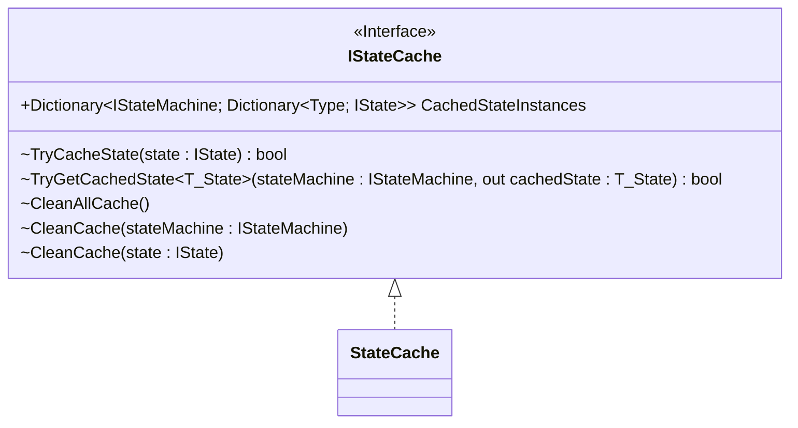

This interface and its implementing class assure the caching mechanism of all created `IState` states under their respective `IStateMachine` FSM owner.
The methods exposed by the interface are encapsulated and implemented in the concrete class as internal virtual methods, offering them to be overridden by any other class in any friend assembly (typically used by a testing project to monitor cache usage).
The partial cleaning of the cache for a specified `IStateMachine` FSM and/or a specified `IState` state will be used when disposing any `IStateMachine` FSM or any `IState` state respectively.
The concrete `StateCache` class is the one that will be used internally, except for friend testing projects that may need a specialized caching implementation for testing purpose of this shared cache.

The cache itself is a `Dictionary<IStateMachine, Dictionary<Type, IState>>` that is automatically populated whenever a new`IState` is required by the `IStateFactory` factory, indexed by the `IStateMachine` object that own the requested `IState` and being further nested to be indexed via its `Type` to ease its access via given concrete type implementing `IState` instead of using object equality or getting type by reflection. 
As a consequence, each FSM could own only one object per concrete `IState` implementing types ; which is coherent as in a FSM every owned state should be unique *(but different FSM can each have their own intance of the same concrete `IState` implementing type)*

---

#### Services

##### Builder

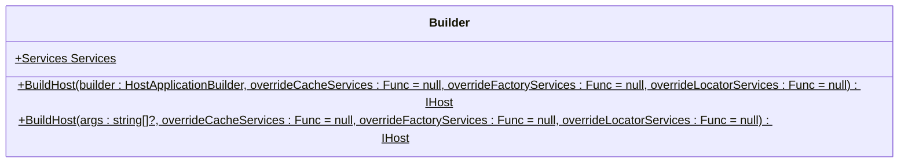

This static class offer a static access to a `Services` service locator instance object.

But its main purpose is to build a configured `HostApplicationBuilder` and return that built `IHost` instance object.

For this it expose 2 overloads of a `BuildHost()` method :

- `BuildHost(string[]?, Func<IServiceCollection, IServiceCollection>?, Func<IServiceCollection, IServiceCollection>?, Func<IServiceCollection, IServiceCollection>?)` that will create a default `HostApplicationBuilder` object that will call its second overload variant on it to actually built and return it. It also try to retreive the potentially registered `Services` instance from that newly built `IHost` to set it to its static `Services` property.

- `BuildHost(HostApplicationBuilder, Func<IServiceCollection, IServiceCollection>?, Func<IServiceCollection, IServiceCollection>?, Func<IServiceCollection, IServiceCollection>?)` that will configure (see Configuration*!!*) the given `HostApplicationBuilder` builder with default or user specified services (factories, cache and service locator) to be registered before building and returning it.

---

##### Configuration

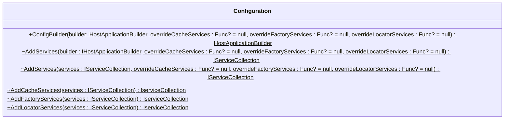

This static class expose the `ConfigBuilder(HostApplicationBuilder, Func<IServiceCollection, IserviceCollection>?, Func<IServiceCollection, IserviceCollection>?, Func<IServiceCollection, IserviceCollection>?)` method to configure a given `HostApplicationBuilder` builder object with factories, cache and service locator services to be registered. It either use user-specified services, via `Func<IServiceCollection, IServiceCollection>` delegates arguments, or built-in library ones, via the other internal methods (default behavior).

---

##### Services

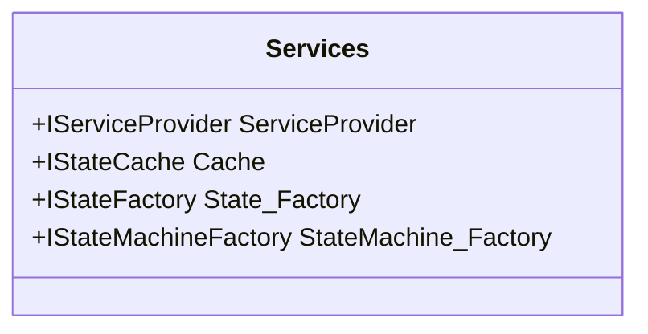

This class serve as a service locator to ease the access of the 2 factories and the cache of this library : `StateFactory`, `StateMachineFactory` and `IStateCache`. 
It may also expose all its registered services at once via its static `ServiceProvider` property.

---

#### Utilities

##### StateChangedEventArgs

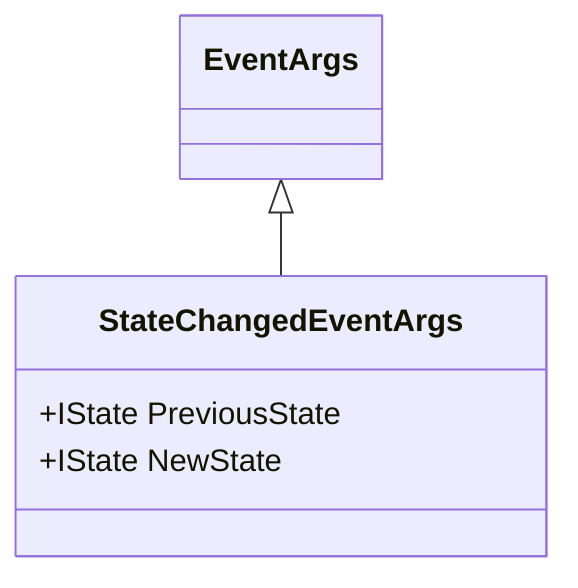

This simple extended `EventArgs` class will be used by all `CurrentStateChanged` event handlers as it allow access to the previous and new `IState` that get transition away and from it.

---

### Finite State Machine (FSM) lifecycle diagram

Here is a visual representation of a FSM lifecycle steps :

```mermaid
flowchart TB
    classDef eventClass fill:#005,stroke:#dd0,stroke-width:3px
    MainStart@{ shape: circle, label: "Start" } --> CreateFSM["Create FSM"]    

    ChangeCurrentState{"CurrentState\n== newValue ?"} -. "`**No**`" .-> CurrentStateChanged(["`**_CurrentStateChanged_**`"]):::eventClass
    InvalidTransition["Invalid\ntransition"] -. raise .-> TransitionFailed(["`**_TransitionFailed_**`"]):::eventClass   
    NextIsEnd{"newValue\n== EndState ?"} -. "`**Yes**`" .-> MachineEnded(["`**_MachineEnded_**`"]):::eventClass  

    subgraph CurrentStateSetter["CurrentState setter"]
    SetterStart@{ shape: circle, label: "Start" } --> ChangeCurrentState
    CurrentStateExit["CurrentState.OnExit()"] --> UpdateCurrentState["CurrentState = newValue"]
    UpdateCurrentState --> NextStateEnter["newValue.OnEnter()"]
    NextStateEnter --> NextIsEnd    
    end

    CreateFSM --> CreateState["Create State"]
    CreateState-- firstState --> InitState["firstState.Init()"]    
    InitState-- firstState --> Init["Initialize FSM"]    
    Init --> AutorunFSM["Autorun FSM"]  
    Init -. raise .-> MachineStarted(["`**_MachineStarted_**`"]):::eventClass  
    ResetFSM -- "`**No**`" --> Dispose
    ResetFSM["Reset FSM"] -- "`**Yes**
    firstState`" --> Init    
    AutorunFSM --> Update    

    subgraph Update ["Update"]
    UpdateStart@{ shape: circle, label: "Start" } --> IsEnded
    IsEnded -- false --> NextStateDecentralized{"CurrentState\n.GetNextState()"}
    NextStateDecentralized -- null --> NextStateCentralized{"GetNextStateCentralized"}
    NextStateCentralized -- null -->  InvalidTransition
    InvalidTransition -- EndState --> CurrentStateSetter
    NextStateCentralized -- nextState --> CurrentStateSetter
    NextStateDecentralized -- nextState --> CurrentStateSetter   
    NextIsEnd --> CurrentStateUpdate    

    ChangeCurrentState -- "`**Yes**`" --> CurrentStateUpdate["CurrentState.Update()"]
    ChangeCurrentState -- "`**No**`" --> CurrentStateExit  
    end    

    IsEnded{"IsEnded"} -- true --> ResetFSM    
    CurrentStateUpdate --> AutorunFSM
    Dispose --> End@{ shape: circle, label: "End" }
```

---

### Usage

#### Usings

This library live in those different namspaces :

- `ReusableFiniteStateMachine.Sources.States[.Interfaces]` for everything related to `IState` and prebuilt `StartState` and `EndState`

- `ReusableFiniteStateMachine.Sources.StateMachine[.Interfaces]` for everything related to `IStateMachine` and `StateMachine`

- `ReusableFiniteStateMachine.Sources.Factories[.Interfaces]` to use this library factories and their implementations

- `ReusableFiniteStateMachine.Sources.Utilities` when dealing with this library  `StateChangedEventArgs`

- `ReusableFiniteStateMachine.Sources.Services` for configuring, building and accessing usefull services from .Net built-in Dependency Injection framework *(`Microsoft.Extensions.Hosting`)*. Built-in ones are enough to have a working FSM implementation.

- `ReusableFiniteStateMachine.Sources.Cache[.Interface]` to use this library cache implementation *(internally as it is an hidden layer used by exposed `IStateFactory` factory)*.

---

#### Factories

In order to create your `IStateMachine` FSM and your `IState` state, you need to use the provided `IStateMachineFactory` and `IStateFactory` factories.

This library offer a simple access point for those by using its `Builder.Services` static property :

```csharp
using ReusableFiniteStateMachine.Sources.Factories.Interfaces;
using ReusableFiniteStateMachine.Sources.Services;

IStateMachineFactory fsmFactory = Builder.Services.StateMachine_Factory;
IStateFactory stateFactory = Builder.Services.State_Factory;
```

---

#### Creation

##### Finite State Machines

To create a new `IStateMachine` simply call this library corresponding factory method via the `Builder.Services` static property :

```csharp
using ReusableFiniteStateMachine.Sources.Services;
using ReusableFiniteStateMachine.Sources.StateMachine.Interfaces;

IStateMachine stateMachine = Builder.Services.StateMachine_Factory.CreateStateMachine();
```

This will return a new built-in `StateMachine` object.

You can also build you own personal `IStateMachine` FSM by deriving from the built-in `StateMachine` class to fit your predefined logic :

```csharp
using ReusableFiniteStateMachine.Sources.Utilities;
using ReusableFiniteStateMachine.Sources.StateMachine;
using ReusableFiniteStateMachine.Sources.StateMachine.Interfaces;

public class MyFSM<T_State> : StateMachine
    where T_State : IState
{ 
    T_State? FirstState 
        => field ??= GetOrAddState<T_State>(this);

    public MyFSM() : base()
    {
        //Automatically initialize and running this FSM whith FirstState when creating it.
        InitializeStateMachine(FirstState, true);
    }
}
```

To then call the `IStateMachineFactory` factory overload generic creation method :

```csharp
using ReusableFiniteStateMachine.Sources.Services;
using ReusableFiniteStateMachine.Sources.StateMachine.Interfaces;

internal class MyState : BaseState
{
    //...
}

IStateMachine stateMachine = Builder.Services.StateMachine_Factory
    .CreateStateMachine<MyFSM<MyState>>();
```

---

##### States

To create a new `IState` you first need to have its `IStateMachine` instance that will own it, and then call its corresponding factory generic method via the `Services` static class with your concrete state type that extend `BaseState` :

```csharp
using ReusableFiniteStateMachine.Sources.Services;
using ReusableFiniteStateMachine.Sources.StateMachine.Interfaces;
using ReusableFiniteStateMachine.Sources.States.Interfaces;

internal class MyState : BaseState
{
    //...
}

MyState myState = Builder.Services.State_Factory
    .GetOrCreateState<MyState>(stateMachine, optionalArgument);
```

###### *Or*

You can use the exposed `IStateMachine.GetOrAddState<T_State>(object?)` alternative method that will end up using the same previous `IStateFactory.GetOrCreateState(IStateMachine, object?)` one in order to ease your states creation :

```csharp
using ReusableFiniteStateMachine.Sources.StateMachine.Interfaces;
using ReusableFiniteStateMachine.Sources.States.Interfaces;

internal class MyState : BaseState
{
    //...
}

MyState myState = stateMachine.GetOrAddState<MyState>(optionalArgument);
```

---

#### Initialization

##### Finite State Machine

To initialize a FSM, you need to have an `IState` instance object that will be the first state of this FSM. You can also pass an extra potential `object?` argument if you need that. FInally, a `bool` flag can be set to automatically run this FSM or not (default is `false`)

```csharp
using ReusableFiniteStateMachine.Sources.StateMachine.Interfaces;
using ReusableFiniteStateMachine.Sources.States.Interfaces;

stateMachine.InitializeStateMachine(firstState, autorun, optionalArgument);
```

---

##### States

In order to initialize you own state you have to override the `BaseState.Init(object?)` method in your state class :

```csharp
using ReusableFiniteStateMachine.Sources.States.Interfaces;

internal class MyState : BaseState
{
    protected override void Init(object? argument = null)
    {
        // your initialization logic here
    }

    //...
}
```

This `Init(object?)` method will be automatically called when creating a new `MyState` object via the `IStateFactory.GetOrCreateState<MyState>(IStateMachine, object?)` factory generic method, and its optional `object?` argument will be passed to `MyState.Init(object?)` method.

---

#### State transition

State transition logic can either follow a centralized paradigm, a decentralized paradigm or a mix of both.
Decentralized version is attempted first and if it fail (returning a `null` `IState`) if falls back to the centralized one.

##### Centralized

With centralized paradigm you centralize all state logic in one place (method). Here we use the `IStateMachine.GetNextStateCentralized` delegate property to callback the method that centralized the state teansition logic :

```csharp
IStateMachine stateMachine = //... your process to get the state machine that you want to code its centralized transition logic here.
stateMachine.GetNextStateCentralized = CentralizedGetNextState;

public IState? CentralizedGetNextState(object? arg)
{
    // will return a new or cached MyState instance.
    IState firstState = stateMachine
        .GetOrAddState<MyState>(optionalArgument);

    return true switch
    {
        _ when stateMachine.CurrentState == stateMachine.StartState
            => firstState,
        _ when stateMachine.CurrentState == stateMachine.EndState
            => stateMachine.EndState,
        _ when stateMachine.CurrentState == firstState
            => stateMachine.EndState,
        _ => arg is IState nextState ? nextState : default
    };
}
```

---

##### Decentralized

With decentralized paradigm you decentralize the state transition logic in each of your states by overriding `IState.GetNextState(object?)` method :

```csharp
using ReusableFiniteStateMachine.Sources.States.Interfaces;

internal class MyState : BaseState
{
    protected override IState? GetNextState(object? argument = null)
    {
        //... your transition logic here to return the next state that this MyState state will transition into.
    }

    //...
}
```

Note that this library built-in `StartState` and `EndState` use this decentralized paradigm with `StartState` returning the `IState` used to initialize its `IStateMachine` owner (the first state of this FSM), and `EndState` returning itself as an ended FSM stay in its `EndState`.

---

##### Entering and exiting

Whenever you transition from a given `IState` into a different one, respectively named here `A_State` and `B_State`, the `IStateMachine` FSM that own them automatically call `A_State.Exit(B_State)` and then `B_State.Enter(A_State)` methods. 
If you need to have your own logic when this happen, you will have to override the `IState.Enter(IState?)` and `IState.Exit(IState?)` methods :

```csharp
using ReusableFiniteStateMachine.Sources.States.Interfaces;

internal class MyState : BaseState
{
    protected override void Enter(IState? previousState)
    {
        // your logic that get executed each time the FSM that own this state transition into this state from previousState.
    }

    protected override void Exit(IState? nextState)
    {
        // your logic that get executed each time the FSM that own this state transition away from this state into nextState.    
    }

    //...
}
```

Note that whereas `BaseState.Init(object?)` is executed only once per `IState`, `IState.Enter(IState?)` and `IState.Exit(IState?)` can be executed several time as a FSM can transition into the same `IState` several time during its run.

---

#### Updating

##### Finite State Machine (FSM)

When you actually want to run your `IStateMachine` FSM, you have to call its `IStateMachine.Update(object?)` method to perform one step of this FSM. 
You can use the built-in `StateMachine` FSM that already have the FSM updating logic implemented. Its optional argument will be forwarded in both its `IStateMachine.GetNextState(object?)` and `CurrentState.Update(object?)` methods. You just need to loop over this `IStateMachine.Update(object?)` method :

```csharp
//... creation and initialization steps here

while(!stateMachine.IsEnded)
{
    stateMachine.Update();
}
```

Or you can use the `IStateMachine.AutorunStateMachine(object?)` method to perform this updating loop. 
Note this method is called when the `autorun` flag parameter is `true` in `IStateMachine.InitializeStateMachine(IState, bool, object?)` method.
The built-in `StateMachine` FSM already have `AutorunStateMachine(object?)` implemented. Its optional argument will be forwarded in its `Update(object?)` method.

```csharp
//... creation and initialization steps here

stateMachine.AutorunStateMachine();
```

---

##### States

Whenever a `IStateMachine` FSM is updating, it will call `IState.Update(object?)` method on its `CurrentState` state.
So by overriding that method in your own state you can execute you own updating logic per states you have :

```csharp
using ReusableFiniteStateMachine.Sources.States.Interfaces;

internal class MyState : BaseState
{
    protected override void Update(object? argument = null)
    {
        // your own updating logic here.
    }

    //...
}
```

---

#### Stoping the Finite State Machine (FSM)

Using the built-in `IStateMachine.AutorunStateMachine(object?)` method, the FSM will automatically stop running when it reach its `EndState` or manually when you call the `IStateMachine.ForceStopStateMachine()` method.
Doing so will cancel its associated `CancellationTokenSource` that in turn will exit the FSM updading loop even if it didn't reach its `EndState` already.

```csharp
//Asynchronously run a task that will eventually stop the running state machine if it doesn't reach its EndState within 20 seconds.
Task.Run(
    async () => {
        await Task.Delay(20_000);      
        stateMachine.ForceStopStateMachine(); 
    }
);
```

---

#### Reseting the Finite State Machine (FSM)

Any FSM can be reset to its initial 'inner state' by calling its `IStateMachine.ResetStateMachine(bool)` method.

```csharp
stateMachine.ResetStateMachine(); //implicit resetCurrentState parameter is true by default.
```

This is usually needed to ensure an already used FSM that might have being stopped prematurely can be futher used again.

---

#### Disposing

##### Finite State Machine (FSM)

You can manually dispose any `IStateMachine` you have created in order to clean the `IStateCache.CachedStateInstances` cache from the `IState` it owns by automatically dispose each of them as well as itself (as being the access key of this cache) by calling its `IDisposable.Dispose()` method :

```csharp
stateMachine.Dispose();
```

Disposing a FSM also reset it.

---

##### States

You can manually dispose any individual `IState` in order to clean its eventual presence in the `IStateCache.CachedStateInstances` cache by calling its `IDisposable.Dispose()` method :

```csharp
firstState.Dispose();
```

---

#### Finite State Machine lifecycle hooking

As described [here](#finite-state-machine-fsm-lifecycle-diagram), a FSM provide 4 events that can be handled to hook into that FSM lifecycle.

##### `MachineStarted`

This event is automatically raised whenever a FSM transition into its `StartState` via its `StartState.OnEnter(IState?)` built-in method.
If you wish to add you own logic when your FSM is starting, you simply have to subscribe your event handlers to its `MachineStarted` event :

```csharp
bool isStarted = false;

stateMachine.MachineStarted += (_, _) => isStarted = true;
```

You can also manually raise this event by calling its `IStateMachine.RaiseStateMachineStarted(EventArgs?)` method.

---

##### `MachineEnded`

This event is automatically raised whenever a FSM transition into its `EndState` via its `EndState.OnEnter(IState?)` built-in method.
If you wish to add you own logic when your FSM is ending, you simply have to subscribe your event handlers to its `MachineEnded` event :

```csharp
bool isEnded = false;

stateMachine.MachineEnded += (_, _) => isEnded = true;
```

You can also manually raise this event by calling its `IStateMachine.RaiseStateMachineEnded(EventArgs?)` method.

---

##### `TransitionFailed`

This event is automatically raised whenever a FSM fail to get a valid (non `null`) next logical `IState` when it is updating itself via its `IStateMachine.Update(object?)` method.

If you wish to add you own logic when your FSM fails its state transition, you simply have to subscribe your event handlers to its `TransitionFailed` event :

```csharp
bool transitionFailedRaised = false;

stateMachine.TransitionFailed += (_, _) => transitionFailedRaised = true;
```

This event cannot be manually raised from outside as its raising logic is encompased inside the FSM updating one.

---

##### `CurrentStateChanged`

This event is automatically raised whenever a FSM have its `IStateMachine.CurrentState` property value changed to a different one.

If you wish to add you own logic when your FSM change its current state (usually when a state transition occur), you have to subscribe your event handlers to its `CurrentStateChanged` event.
This event have the particularity to use the specific `StateChangedEventArgs` as its argument in order to provide to their event handlers a way to retreive both the previous and new `IState` value of the being changed `CurrentState` value :

```csharp
stateMachine.CurrentStateChanged += _DisplayChangingCurrentState

private void _DisplayChangingCurrentState(object? sender, StateChangedEventArgs stateChangedEventArgs)
 => Console.WriteLine($"{sender?.GetType().Name} state transition :\n  [{stateChangedEventArgs.PreviousState.GetType().Name}] -> [{stateChangedEventArgs.NewState.GetType().Name}]");
```

This event cannot be manually raised from outside as its raising logic is encompased inside the FSM `CurrentState` setter mechanism.

---

##### Flushing events

Those `IStateMachine` state machine lifecycle events can have their registered event handlers being flushed at once by calling their respective flushing methods

```csharp
//Flush/remove all registered event handler of MachineStarted event
stateMachine.FlushMachineStarted();
//Flush/remove all registered event handler of MachineEnded event
stateMachine.FlushMachineEnded();
//Flush/remove all registered event handler of TransitionFailed event
stateMachine.FlushTransitionFailed();
//Flush/remove all registered event handler of CurrentStateChanged event
stateMachine.FlushCurrentStateChanged();
```

If you need to flush all registered event handlers of those 4 events of a given `IStateMAchine` state machine at once, you can call its `FlushMachineEvents()` method :

```csharp
//Flush/remove all registered event handlers of all events of a given IStateMachine object at once
stateMachine.FlushMachineEvents();
```

This is used when a `IStateMachine` needs to be reseted (see [here](#resetting-the-finite-state-machine-fsm)).

---

### Example

Here is a simple traffic lights simulation that use this library Finite State Machine to handle the light cycle :

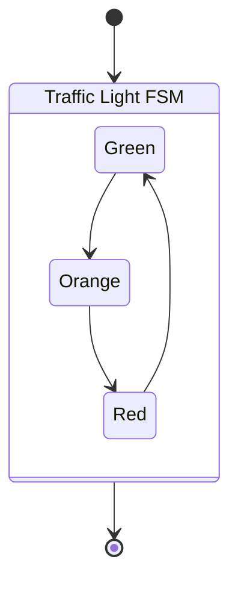

---

Creating the underlying `IState` states needed for this traffic light simulation :

```csharp
using ReusableFiniteStateMachine.Sources.States.Interfaces;

internal abstract class BaseTrafficLightState : BaseState
{
  protected int _tick = 0;
  protected int _delay = 2;

  internal void Tick() => _tick++;

  protected override void Init(object? argument = null)
    => _delay = argument is int delay ? delay : 2;

  public override void OnEnter(IState? previousState)
  {
    Console.WriteLine($"\n--- [{DateTime.Now:mm:ss:ff}] Entering => {GetType().Name} ---\n");

    //Reset inner timer's count before starting the (shared) Timer.
    _tick = 0;

    TimerExtensions.StoppableTimer
        .StartTimer(TimeSpan.FromSeconds(_delay));
  }

  public override void OnExit(IState? nextState)
  {
    TimerExtensions.StoppableTimer.StopTimer();

    Console.WriteLine($"\n--- [{DateTime.Now:mm:ss:ff}] Exiting <= {GetType().Name} ---\n");      
  }

  public override void Update(object? argument = null)
  { }
}
```

```csharp
using ReusableFiniteStateMachine.Sources.States;
using ReusableFiniteStateMachine.Sources.States.Interfaces;
using ReusableFiniteStateMachine.Sources.StateMachine.Interfaces;
using ReusableFiniteStateMachine.Sources.Services;

internal class GreenState : BaseTrafficLightState
{
  private static int _loopAmount = 0;

  public override IState? GetNextState(object? argument = null)
    => _loopAmount > 8 ? StateMachineOwner?.GetOrAddState<EndState>() :
       _tick > 1 ? StateMachineOwner?.GetOrAddState<OrangeState>(1) : this;

  public override void OnEnter(IState? previousState)
  {
    Console.WriteLine($"--- [#{_loopAmount}] {(_loopAmount >= 8 ? "(LAST) " : "")}---");
    base.OnEnter(previousState);
    _loopAmount++;
  }
}
```

```csharp
using ReusableFiniteStateMachine.Sources.States.Interfaces;
using ReusableFiniteStateMachine.Sources.Services;

internal class OrangeState : BaseTrafficLightState
{  
  public override IState? GetNextState(object? argument = null)
    => _tick > 1 ? StateMachineOwner?.GetOrCreateState<RedState>(3) : this;
}
```

```csharp
using ReusableFiniteStateMachine.Sources.States.Interfaces;
using ReusableFiniteStateMachine.Sources.Services;

internal class RedState : BaseTrafficLightState
{
   public override IState? GetNextState(object? argument = null)
    => _tick > 1 ? StateMachineOwner?.GetOrCreateState<GreenState>(2) : this;
}
```

---

The static extension class used to ease the use of a `System.Threading.Timer` :

```csharp
public static class TimerExtensions : IDisposable
{
  public static TimerCallback TimerCallback { get; set; }

  private static Timer _stoppableTimer;
  public static Timer StoppableTimer 
    => _stoppableTimer ??= new(
      TimerCallback,
      default,
      Timeout.Infinite,
      Timeout.Infinite);

  public static void StartTimer(this Timer timer, TimeSpan period)
    => StoppableTimer?.Change(TimeSpan.Zero, period);

  public static void StopTimer(this Timer timer)
    => StoppableTimer?.Change(Timeout.Infinite, Timeout.Infinite);

  public void Dispose()
  {
    StoppableTimer.Dispose();
    _timer = default;
    _timerCallback = default;
  }
}
```

---

And using them to feed a FSM that will simulate a cycling traffic light as depicted [here](#example) :

```csharp
using ReusableFiniteStateMachine.Sources.StateMachine.Interfaces;
using ReusableFiniteStateMachine.Sources.Services;

Console.WriteLine($"\n--- TESTING Reusable Finite State Machine ---\n");
var stateMachine = Builder.Services.StateMachine_Factory
                    .CreateStateMachine();

if (stateMachine == null)
{
  Console.WriteLine($"\n--- ERROR created {nameof(IStateMachine)} is NULL! ---\n");
  return;
}

Console.WriteLine($"\n--- Created {stateMachine.GetType().Name} ---\n");

TimerExtensions.TimerCallback = _ =>
{
  if (stateMachine.CurrentState is BaseTrafficLightState lightState)
    lightState.Tick();
};

bool stopUpdateLoop = false;

void MachineEnded(object? sender, EventArgs e)
{
  Console.WriteLine($"\n--- ENDING Reusable Finite State Machine ---\n");
  stopUpdateLoop = true;
}

stateMachine.MachineEnded += MachineEnded;

var firstState = stateMachine.GetOrCreateState<GreenState>(2);

if (firstState == default)
{
  Console.WriteLine($"\n--- ERROR created {nameof(GreenState)} is NULL! ---\n");
  return;
}

Console.WriteLine($"\n--- Created {firstState.GetType().Name} ---\n");

Console.WriteLine($"\n--- STARTING Reusable Finite State Machine ---\n");

stateMachine.InitializeStateMachine(firstState, true);

//Asynchronously run a task that will stop the running state machine after 50 seconds preventing a potential infinite updating loop.
Task.Run(
  async () => 
    { 
      await Task.Delay(50_000); 
      stateMachine.ForceStopStateMachine(); 
    }
  );

Console.WriteLine($"\n--- Requested stopping machine : {stopUpdateLoop}\n--- Played {loopAmount} loops ---\n");
```

---

#### Warning :

I decline all responsibility of any damage this application could done on your device.
Be careful of any hacking, as I didn't implement any security check.

---

#### Icon file :

The `rfsm_icon.png` also named `icon.png` file, the icon of this library and its corresponding nuget package, is created by [Aurélien Pascal Maignan](https://github.com/elTRexx) licensed under [Creative Commons Attribution-NonCommercial-ShareAlike 4.0 International License](http://creativecommons.org/licenses/by-nc-sa/4.0/).

[](http://creativecommons.org/licenses/by-nc-sa/4.0/)

---

### Licenses :

**“Commons Clause” License Condition v1.0**

The Software is provided to you by the Licensor under the License,
as defined below, subject to the following condition.

Without limiting other conditions in the License, the grant of rights
under the License will not include, and the License does not grant to you,
the right to Sell the Software.

For purposes of the foregoing, “Sell” means practicing any or all of the rights
granted to you under the License to provide to third parties, for a fee or other consideration
(including without limitation fees for hosting or consulting/ support services related to the Software),
a product or service whose value derives, entirely or substantially, from the functionality of the Software.

Any license notice or attribution required by the License must also include this
Commons Clause License Condition notice.

Software: Reusable Finite State Machine

Licenses: CeCILL-B and CeCILL-C

Licensor: [Aurélien Pascal Maignan](https://github.com/elTRexx)

---

### CeCILL-C

Copyright or © or Copr. [Aurélien Pascal Maignan](https://github.com/elTRexx) (25 October 2026)

[aurelien.maignan@protonmail.com](mailto:aurelien.maignan@protonmail.com)

This software is a library program whose purpose is to offer a reusable finite state machine implementation as a library.

This software is governed by the CeCILL-C license under French law and
abiding by the rules of distribution of free software. You can use,
modify and/ or redistribute the software under the terms of the CeCILL-B
license as circulated by CEA, CNRS and INRIA at the following URL
"[http://www.cecill.info](http://www.cecill.info)".

As a counterpart to the access to the source code and rights to copy,
modify and redistribute granted by the license, users are provided only
with a limited warranty and the software's author, the holder of the
economic rights, and the successive licensors have only limited
liability.

In this respect, the user's attention is drawn to the risks associated
with loading, using, modifying and/or developing or reproducing the
software by the user in light of its specific status of free software,
that may mean that it is complicated to manipulate, and that also
therefore means that it is reserved for developers and experienced
professionals having in-depth computer knowledge. Users are therefore
encouraged to load and test the software's suitability as regards their
requirements in conditions enabling the security of their systems and/or
data to be ensured and, more generally, to use and operate it in the
same conditions as regards security.

The fact that you are presently reading this means that you have had
knowledge of the CeCILL-C license and that you accept its terms.

---

### CeCILL-B

Copyright or © or Copr. [Aurélien Pascal Maignan](https://github.com/elTRexx) (25 October 2026)

[aurelien.maignan@protonmail.com](mailto:aurelien.maignan@protonmail.com)

Those softwares are testing projects (`FiniteStateMachineConsoleTest`, `TestingReusableFiniteStateMachinePackage` and `ReusableFiniteStateMachine.Tests`) whose purpose are to test the Reusable Finite State Machine library program.

This software is governed by the CeCILL-B license under French law and
abiding by the rules of distribution of free software. You can use,
modify and/ or redistribute the software under the terms of the CeCILL-B
license as circulated by CEA, CNRS and INRIA at the following URL
"[http://www.cecill.info](http://www.cecill.info)".

As a counterpart to the access to the source code and rights to copy,
modify and redistribute granted by the license, users are provided only
with a limited warranty and the software's author, the holder of the
economic rights, and the successive licensors have only limited
liability.

In this respect, the user's attention is drawn to the risks associated
with loading, using, modifying and/or developing or reproducing the
software by the user in light of its specific status of free software,
that may mean that it is complicated to manipulate, and that also
therefore means that it is reserved for developers and experienced
professionals having in-depth computer knowledge. Users are therefore
encouraged to load and test the software's suitability as regards their
requirements in conditions enabling the security of their systems and/or
data to be ensured and, more generally, to use and operate it in the
same conditions as regards security.

The fact that you are presently reading this means that you have had
knowledge of the CeCILL-B license and that you accept its terms.

---

**Creative Commons Attribution-NonCommercial-ShareAlike 4.0 International Public License**

By exercising the Licensed Rights (defined below), You 
accept and agree to be bound by the terms and conditions of this 
Creative Commons Attribution-NonCommercial-ShareAlike 4.0 International 
Public License ("Public License"). To the extent this Public License may
 be interpreted as a contract, You are granted the Licensed Rights in 
consideration of Your acceptance of these terms and conditions, and the 
Licensor grants You such rights in consideration of benefits the 
Licensor receives from making the Licensed Material available under 
these terms and conditions.

Section 1 – Definitions.

```
Adapted Material means material subject to Copyright and Similar Rights that is derived from or based upon the Licensed Material and in which the Licensed Material is translated, altered, arranged, transformed, or otherwise modified in a manner requiring permission under the Copyright and Similar Rights held by the Licensor. For purposes of this Public License, where the Licensed Material is a musical work, performance, or sound recording, Adapted Material is always produced where the Licensed Material is synched in timed relation with a moving image.
Adapter's License means the license You apply to Your Copyright and Similar Rights in Your contributions to Adapted Material in accordance with the terms and conditions of this Public License.
BY-NC-SA Compatible License means a license listed at creativecommons.org/compatiblelicenses, approved by Creative Commons as essentially the equivalent of this Public License.
Copyright and Similar Rights means copyright and/or similar rights closely related to copyright including, without limitation, performance, broadcast, sound recording, and Sui Generis Database Rights, without regard to how the rights are labeled or categorized. For purposes of this Public License, the rights specified in Section 2(b)(1)-(2) are not Copyright and Similar Rights.
Effective Technological Measures means those measures that, in the absence of proper authority, may not be circumvented under laws fulfilling obligations under Article 11 of the WIPO Copyright Treaty adopted on December 20, 1996, and/or similar international agreements.
Exceptions and Limitations means fair use, fair dealing, and/or any other exception or limitation to Copyright and Similar Rights that applies to Your use of the Licensed Material.
License Elements means the license attributes listed in the name of a Creative Commons Public License. The License Elements of this Public License are Attribution, NonCommercial, and ShareAlike.
Licensed Material means the artistic or literary work, database, or other material to which the Licensor applied this Public License.
Licensed Rights means the rights granted to You subject to the terms and conditions of this Public License, which are limited to all Copyright and Similar Rights that apply to Your use of the Licensed Material and that the Licensor has authority to license.
Licensor means the individual(s) or entity(ies) granting rights under this Public License.
NonCommercial means not primarily intended for or directed towards commercial advantage or monetary compensation. For purposes of this Public License, the exchange of the Licensed Material for other material subject to Copyright and Similar Rights by digital file-sharing or similar means is NonCommercial provided there is no payment of monetary compensation in connection with the exchange.
Share means to provide material to the public by any means or process that requires permission under the Licensed Rights, such as reproduction, public display, public performance, distribution, dissemination, communication, or importation, and to make material available to the public including in ways that members of the public may access the material from a place and at a time individually chosen by them.
Sui Generis Database Rights means rights other than copyright resulting from Directive 96/9/EC of the European Parliament and of the Council of 11 March 1996 on the legal protection of databases, as amended and/or succeeded, as well as other essentially equivalent rights anywhere in the world.
You means the individual or entity exercising the Licensed Rights under this Public License. Your has a corresponding meaning.
```

Section 2 – Scope.

```
License grant.
    Subject to the terms and conditions of this Public License, the Licensor hereby grants You a worldwide, royalty-free, non-sublicensable, non-exclusive, irrevocable license to exercise the Licensed Rights in the Licensed Material to:
        reproduce and Share the Licensed Material, in whole or in part, for NonCommercial purposes only; and
        produce, reproduce, and Share Adapted Material for NonCommercial purposes only.
    Exceptions and Limitations. For the avoidance of doubt, where Exceptions and Limitations apply to Your use, this Public License does not apply, and You do not need to comply with its terms and conditions.
    Term. The term of this Public License is specified in Section 6(a).
    Media and formats; technical modifications allowed. The Licensor authorizes You to exercise the Licensed Rights in all media and formats whether now known or hereafter created, and to make technical modifications necessary to do so. The Licensor waives and/or agrees not to assert any right or authority to forbid You from making technical modifications necessary to exercise the Licensed Rights, including technical modifications necessary to circumvent Effective Technological Measures. For purposes of this Public License, simply making modifications authorized by this Section 2(a)(4) never produces Adapted Material.
    Downstream recipients.
        Offer from the Licensor – Licensed Material. Every recipient of the Licensed Material automatically receives an offer from the Licensor to exercise the Licensed Rights under the terms and conditions of this Public License.
        Additional offer from the Licensor – Adapted Material. Every recipient of Adapted Material from You automatically receives an offer from the Licensor to exercise the Licensed Rights in the Adapted Material under the conditions of the Adapter’s License You apply.
        No downstream restrictions. You may not offer or impose any additional or different terms or conditions on, or apply any Effective Technological Measures to, the Licensed Material if doing so restricts exercise of the Licensed Rights by any recipient of the Licensed Material.
    No endorsement. Nothing in this Public License constitutes or may be construed as permission to assert or imply that You are, or that Your use of the Licensed Material is, connected with, or sponsored, endorsed, or granted official status by, the Licensor or others designated to receive attribution as provided in Section 3(a)(1)(A)(i).

Other rights.
    Moral rights, such as the right of integrity, are not licensed under this Public License, nor are publicity, privacy, and/or other similar personality rights; however, to the extent possible, the Licensor waives and/or agrees not to assert any such rights held by the Licensor to the limited extent necessary to allow You to exercise the Licensed Rights, but not otherwise.
    Patent and trademark rights are not licensed under this Public License.
    To the extent possible, the Licensor waives any right to collect royalties from You for the exercise of the Licensed Rights, whether directly or through a collecting society under any voluntary or waivable statutory or compulsory licensing scheme. In all other cases the Licensor expressly reserves any right to collect such royalties, including when the Licensed Material is used other than for NonCommercial purposes.
```

Section 3 – License Conditions.

Your exercise of the Licensed Rights is expressly made subject to the following conditions.

```
Attribution.

    If You Share the Licensed Material (including in modified form), You must:
        retain the following if it is supplied by the Licensor with the Licensed Material:
            identification of the creator(s) of the Licensed Material and any others designated to receive attribution, in any reasonable manner requested by the Licensor (including by pseudonym if designated);
            a copyright notice;
            a notice that refers to this Public License;
            a notice that refers to the disclaimer of warranties;
            a URI or hyperlink to the Licensed Material to the extent reasonably practicable;
        indicate if You modified the Licensed Material and retain an indication of any previous modifications; and
        indicate the Licensed Material is licensed under this Public License, and include the text of, or the URI or hyperlink to, this Public License.
    You may satisfy the conditions in Section 3(a)(1) in any reasonable manner based on the medium, means, and context in which You Share the Licensed Material. For example, it may be reasonable to satisfy the conditions by providing a URI or hyperlink to a resource that includes the required information.
    If requested by the Licensor, You must remove any of the information required by Section 3(a)(1)(A) to the extent reasonably practicable.
ShareAlike.

In addition to the conditions in Section 3(a), if You Share Adapted Material You produce, the following conditions also apply.
    The Adapter’s License You apply must be a Creative Commons license with the same License Elements, this version or later, or a BY-NC-SA Compatible License.
    You must include the text of, or the URI or hyperlink to, the Adapter's License You apply. You may satisfy this condition in any reasonable manner based on the medium, means, and context in which You Share Adapted Material.
    You may not offer or impose any additional or different terms or conditions on, or apply any Effective Technological Measures to, Adapted Material that restrict exercise of the rights granted under the Adapter's License You apply.
```

Section 4 – Sui Generis Database Rights.

Where the Licensed Rights include Sui Generis Database Rights that apply to Your use of the Licensed Material:

```
for the avoidance of doubt, Section 2(a)(1) grants You the right to extract, reuse, reproduce, and Share all or a substantial portion of the contents of the database for NonCommercial purposes only;
if You include all or a substantial portion of the database contents in a database in which You have Sui Generis Database Rights, then the database in which You have Sui Generis Database Rights (but not its individual contents) is Adapted Material, including for purposes of Section 3(b); and
You must comply with the conditions in Section 3(a) if You Share all or a substantial portion of the contents of the database.
```

For the avoidance of doubt, this Section 4
 supplements and does not replace Your obligations under this Public 
License where the Licensed Rights include other Copyright and Similar 
Rights.

Section 5 – Disclaimer of Warranties and Limitation of Liability.

```
Unless otherwise separately undertaken by the Licensor, to the extent possible, the Licensor offers the Licensed Material as-is and as-available, and makes no representations or warranties of any kind concerning the Licensed Material, whether express, implied, statutory, or other. This includes, without limitation, warranties of title, merchantability, fitness for a particular purpose, non-infringement, absence of latent or other defects, accuracy, or the presence or absence of errors, whether or not known or discoverable. Where disclaimers of warranties are not allowed in full or in part, this disclaimer may not apply to You.
To the extent possible, in no event will the Licensor be liable to You on any legal theory (including, without limitation, negligence) or otherwise for any direct, special, indirect, incidental, consequential, punitive, exemplary, or other losses, costs, expenses, or damages arising out of this Public License or use of the Licensed Material, even if the Licensor has been advised of the possibility of such losses, costs, expenses, or damages. Where a limitation of liability is not allowed in full or in part, this limitation may not apply to You.

The disclaimer of warranties and limitation of liability provided above shall be interpreted in a manner that, to the extent possible, most closely approximates an absolute disclaimer and waiver of all liability.
```

Section 6 – Term and Termination.

```
This Public License applies for the term of the Copyright and Similar Rights licensed here. However, if You fail to comply with this Public License, then Your rights under this Public License terminate automatically.

Where Your right to use the Licensed Material has terminated under Section 6(a), it reinstates:
    automatically as of the date the violation is cured, provided it is cured within 30 days of Your discovery of the violation; or
    upon express reinstatement by the Licensor.
For the avoidance of doubt, this Section 6(b) does not affect any right the Licensor may have to seek remedies for Your violations of this Public License.
For the avoidance of doubt, the Licensor may also offer the Licensed Material under separate terms or conditions or stop distributing the Licensed Material at any time; however, doing so will not terminate this Public License.
Sections 1, 5, 6, 7, and 8 survive termination of this Public License.
```

Section 7 – Other Terms and Conditions.

```
The Licensor shall not be bound by any additional or different terms or conditions communicated by You unless expressly agreed.
Any arrangements, understandings, or agreements regarding the Licensed Material not stated herein are separate from and independent of the terms and conditions of this Public License.
```

Section 8 – Interpretation.

```
For the avoidance of doubt, this Public License does not, and shall not be interpreted to, reduce, limit, restrict, or impose conditions on any use of the Licensed Material that could lawfully be made without permission under this Public License.
To the extent possible, if any provision of this Public License is deemed unenforceable, it shall be automatically reformed to the minimum extent necessary to make it enforceable. If the provision cannot be reformed, it shall be severed from this Public License without affecting the enforceability of the remaining terms and conditions.
No term or condition of this Public License will be waived and no failure to comply consented to unless expressly agreed to by the Licensor.
Nothing in this Public License constitutes or may be interpreted as a limitation upon, or waiver of, any privileges and immunities that apply to the Licensor or You, including from the legal processes of any jurisdiction or authority.
```