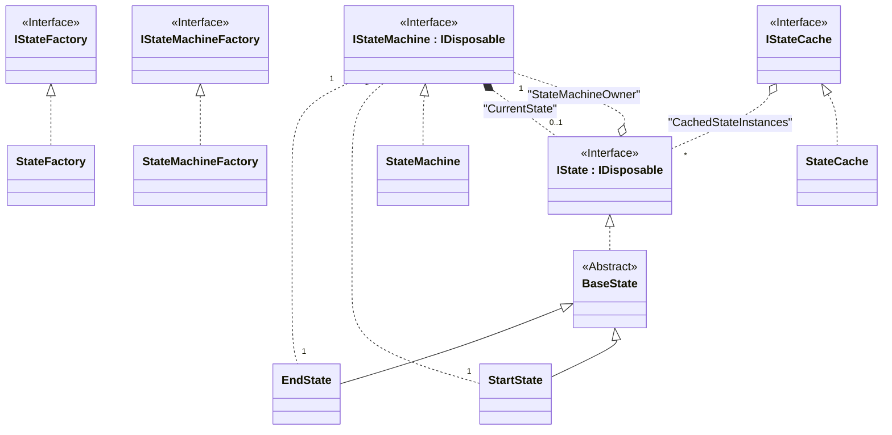
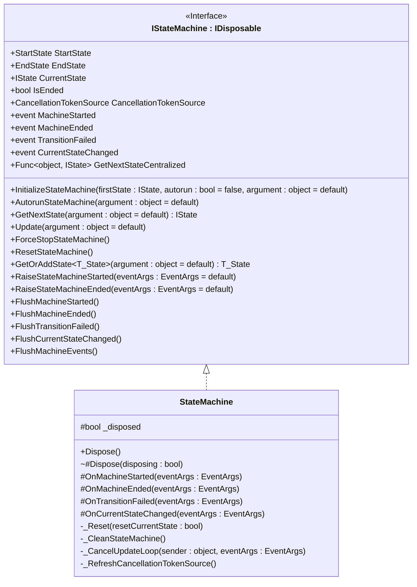
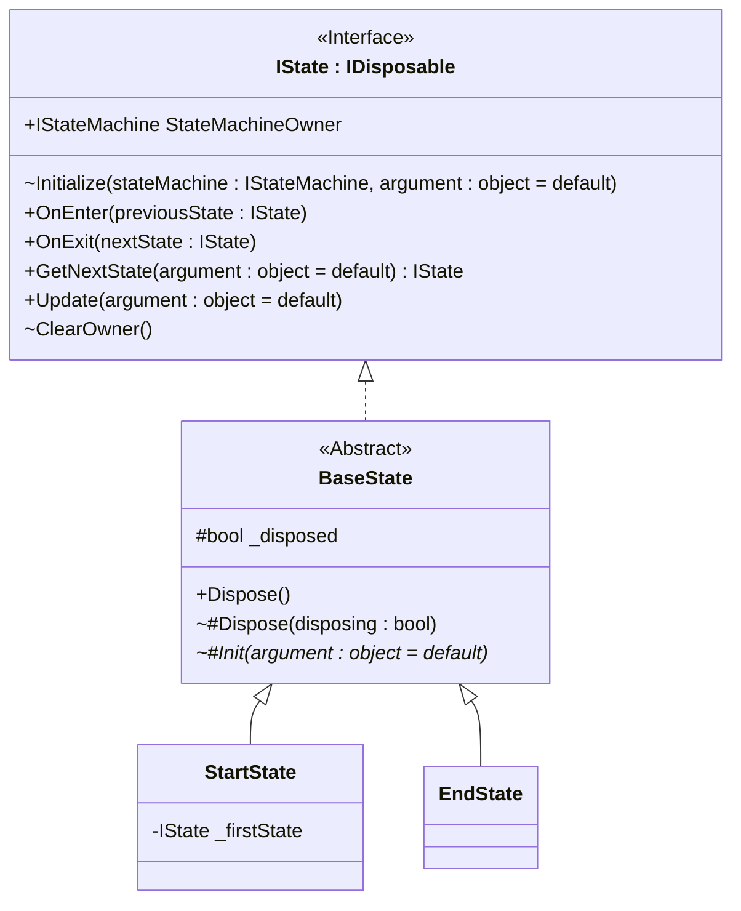
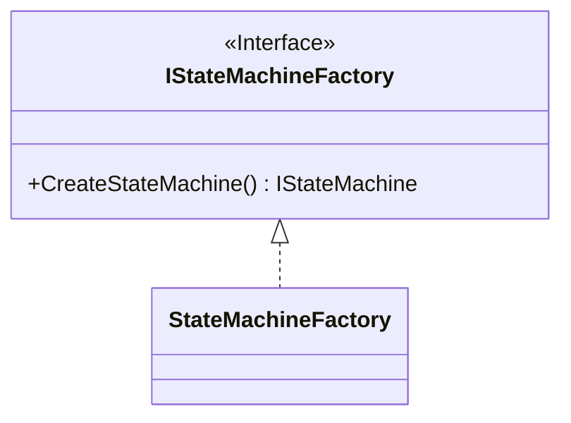
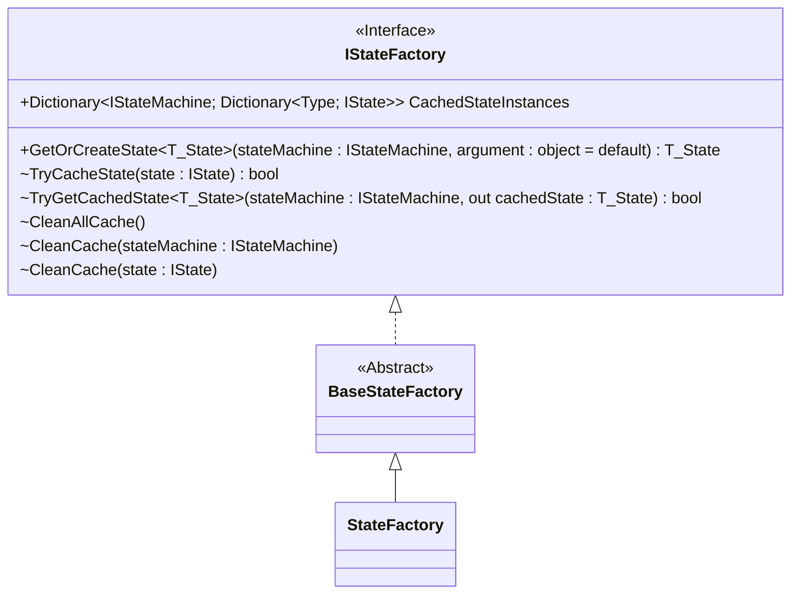
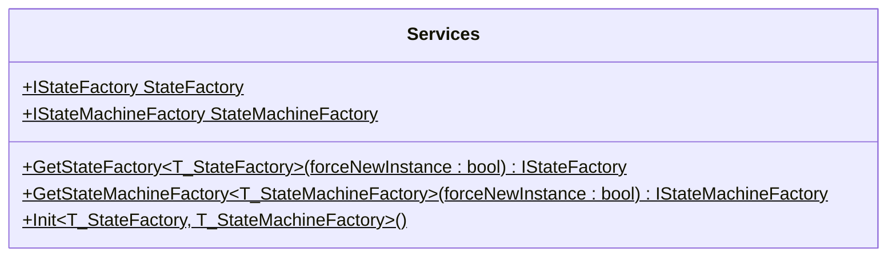
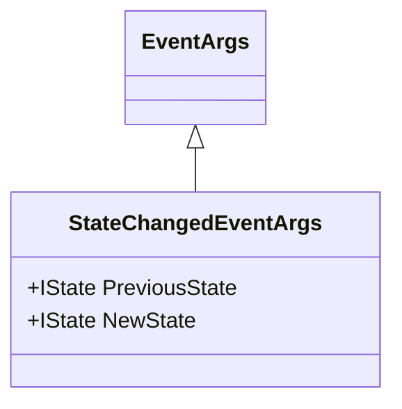
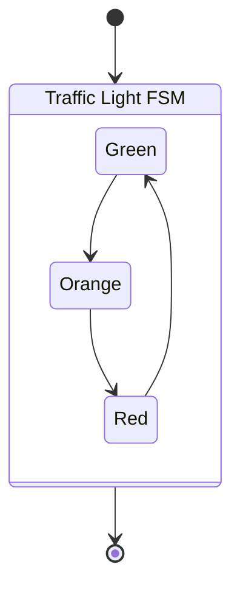

# Reusable Finite State Machine

________ 

## A simple Finite State Machine (FSM) implementation that you can reuse for your own needs.

__________

### Context

#### Origin :

As I was exploring Godot game engine, I wanted to create a simple POC game, and quickly ends up using built in Godot FSM for animation. But I then prefered to use my own implentation, abtract enough to be reusable. 
As a simple and small project, it became naturally a good candidate for me to learn and explore the new testing framwork [TUnit](https://github.com/thomhurst/TUnit) developped by Tom Longhurst, whose main  "selling" point from well known framework like [xUnit](https://github.com/xunit/) is to rely on source code generation underneath instead of code reflexivity with the promise to be more performant.

___________

#### Developing journey :

Being aware that software testing is a precious skill for a computer scientist that I was lacking of, I seized the opportunity of a new and promissing testing framework being released, [TUnit](https://github.com/thomhurst/TUnit), to fill this gap. A project I just created was the perfect candidate at it is a small and simple one to aquire this testing mindset.

I began by implementing my solution and testing it like I'm used to do before with a side console application testing project. 
That assured me that my FSM library was stable enough to then be focused only on exploring and learning software (Unit - Integration - Fonctionnal - End To End) testing "phylosophy" while also learning the concrete implementation of the new promissing testing framework [TUnit](https://github.com/thomhurst/TUnit).

I used to read/watch several tutorial on software testing being framework agnostic or not. (mainly referenced as Unit testing though they usually also explore integration testing). 

For [TUnit](https://github.com/thomhurst/TUnit) itself, as a new framework, there is very few external ressource to learn it. But its main developer, Tom longhusrt, id doing a very good job [documenting his solution](https://tunit.dev/) and he was also helping me directly on his github repository to answer my questions.

The main issue I had with [TUnit](https://github.com/thomhurst/TUnit) was that I'm using Visual Studio 2022 and being restricted at using .Net 9.0 and C# 14 in preview mode. Some older versions of [TUnit](https://github.com/thomhurst/TUnit) was working while newer one not. The issue revolved around building toolchain and package versions conflicts. I do not use Visual Studio 2026, but I supose the up-to-date building toolchain might have resolved the issue. You can read my invistigation [here](https://github.com/thomhurst/TUnit/discussions/5248) if you are curious.

Except that itchy specific issue, learning unit testing was pretty smooth, both in using [TUnit](https://github.com/thomhurst/TUnit) and embrassing more and more the "art" of testing.

__________

#### Axes of improvements :

- The simulated test game player FSM revolve on using a static class hodling 'inner game state' acting kind of like global properties (bad practice).

- For end to end testing I'm using a batch of N repeated 30 seconds timed out test, but I am not sure it is a correct way for end to end testing.

- Using a `Dictionary<IStateMachine,Dictionary<Type,IState>` as a cache that also describe the ownership relationship of `IState` states owned by each `IStateMachine` FSM might not be the cleanest choice.

- Having some methods being virtual merely only for testing purpose (taking advantage of mocking verification) might not worth the overhead.

- Likewise, architectrually offering the factories to be specialized for testing purpose might not worth it.

- This library is simple it (almost) doesn't need an IoC / D.I. mechanism. But using some may have been better in the pursue of learning testing. Indeed, testing is a case that usually take advantage of D.I. for substituting test classes fixtures and mocks.

________

#### Testing :

My main personnal purpose of this library is to improve my testing skills.

For that I choose to use new [TUnit](https://github.com/thomhurst/TUnit) testing framework to take advantage of this discovering mindset process of both a paradigm and a backend framework supporting it.
Experimented as both an advantage and a drawback of it, was to be confronted of some bugs of [TUnit](https://github.com/thomhurst/TUnit) while using it. 
Those are expected consequences of any a new and WIP framework like [TUnit](https://github.com/thomhurst/TUnit) is. 
The advantage was to better understanding how the inner mechanisms of such a testing framework work, and I would like to emphasis that the person behind [TUnit](https://github.com/thomhurst/TUnit) was of great help when I needed some.
The drawback was more time consuming and being then less effective for learning only.
The main disadvantage of my choice to explore [TUnit](https://github.com/thomhurst/TUnit) here is to be less familliar with more commonlly used testing framework like [xUnit](https://github.com/xunit/xunit), [NUnit](https://github.com/nunit/nunit) and [MSTest](https://github.com/microsoft/testfx).
This can be debattable of course, but I consider having a good proportion for adaptation and being able to transfer learned skills to other practical implemetations. 
So I consider that disadvantage less proeminent for me.

---

### Description

This library is articulated around 4 main parts :

- States with a base abstract class from which to derive all others concrete used ones with per-state life cycle (Enter -> Update -> Exit)

- Finite State Machine (FSM) that drive the flow of states to transition from and into along a centralized or decentralized paradigm (prioritizing decentralized one)

- Factories to encapsulate States and State machines objects creation

- Utilities classes

---

#### Class diagram



---

#### Finite State Machine (FSM)



You can use the built-in FSM implementation of this library by using `ReusableFiniteStateMachine.Sources.Factories.StateMachineFactory.CreateStateMachine()` factory method that will simply return a new `ReusableFiniteStateMachine.Sources.StateMachine.StateMachine` object.

Or you can create your own specialized class implementation by deriving from `ReusableFiniteStateMachine.Sources.StateMachine.StateMachine`. (see [FSM creation](#creation))

This drive the FSM lifecycle by assuring a states flow via transition rules from states to states either centralized in one place or decentralized in each states (or even a mix of both paradigms). 
Each main steps of the FSM can be responded via an event driven approch.

There is 4 main lifecycle step and corresponding events :

- `MachineStarted` when the FSM just started

- `MachineEnded` when the FSM just ended

- `TransitionFailed` when a state transition of a running FSM failed

- `CurrentStateChanged` when the FSM just transitionned away from a given state to a different one.

The `ReusableFiniteStateMachine.Sources.StateMachine.Interfaces.IStateMachine` interface expose thoses

- Properties
  
  - `StartState`
  
  - `EndState`
  
  - `CurrentState`
  
  - `IsEnded`
  
  - `CancellationTokenSource`
  
  - `GetNextStateCentralized`

- Methods :
  
  - `InitializeStateMachine(IState, bool, object?)`
  
  - `AutorunStateMachine(object?)`
  
  - `GetNextState(object?)`
  
  - `Update(object?)`
  
  - `ForceStopStateMachine()`
  
  - `ResetStateMachine()`
  
  - `GetOrAddState<T_State>(object?)`
  
  - `RaiseStateMachineStarted(EventArgs?)`
  
  - `RaiseStateMachineEnded(EventArgs?)`
  
  - `FlushMachineStarted()`
  
  - `FlushMachineEnded()`
  
  - `FlushTransitionFailed()`
  
  - `FlushCurrentStateChanged()`
  
  - `FlushMachineEvents()`
  
  - `Dispose()`

- Events
  
  - `MachineStarted`
  
  - `MachineEnded`
  
  - `TransitionFailed`
  
  - `CurrentStateChanged`

##### Properties

###### `StartState`

The `StartState` object instance for this FSM (one for each FSM instances)

###### `EndState`

The `EndState` object instance for this FSM (one for each FSM instances)

###### `CurrentState`

The `IState` implementing object instance that is the current active state of this FSM

Changing this property value to a different `IState` will automatically call `OnExit()` on the state to transition away and `OnEnter()` on the state to transition into. It also raise `OnCurrentStateChanged` event.

###### `IsEnded`

Checking if this FSM `CurrentState` is equal to this FSM `EndState` meaning this FSM is not running

###### `CancellationTokenSource`

###### `GetNextStateCentralized`

The delegate method that will encapsulate all centralized transition logic that fallback to be called whenever decentralized transition logic of the `CurrentState` return a `null` value.

##### Methods

###### `InitializeStateMachine(IState, bool, object?)`

Initializing this FSM with the first state to transition into from its `StartState` and either automaticcaly start running it or not (default is not). You can also pass additional argument(s) in case you need them for your FSM initialization.

###### `AutorunStateMachine(object?)`

Create a asynchronous`Task` that run this FSM via a looping `Update` calls until its `CancellationTokenSource` is cancelled.

###### `GetNextState(object?)`

Gettting the next logical `IState` of this FSM `CurrentState`, either decentralized (prioritized) or centralized via its `GetNextStateCentralized` delegate callback.

###### `Update(object?)`

Updating this FSM by getting the next logical state to transition into and calling this potential new state own `Update(object?)` method.

###### `ForceStopStateMachine()`

Manually cancel the FSM `CancellationTokenSource` to force stoping it.

###### `ResetStateMachine()`

Reset this FSM to its initial 'inner state' (fields and properties) to their default values

###### `GetOrAddState<T_State>(object?)`

Get directly return the owned state of type `T_State` is already registered under this state machine in the `IStateFactory.CachedStateInstances` cache or create a new one, register it under this state machine as its owner in that cache and return it.

###### `RaiseStateMachineStarted(EventArgs?)`

Raise associated `MachineStarted` event with any potential given `EventArgs` arguments.

###### `RaiseStateMachineEnded(EventArgs?)`

Raise associated `MachineEnded` event with any potential given `EventArgs` arguments.

###### `FlushMachineStarted()`

Flush this FSM `MachineStarted` event of all potential remaining registered handler(s) to it.

###### `FlushMachineEnded()`

Flush this FSM `MachineEnded` event of all potential remaining registered handler(s) to it.

###### `FlushTransitionFailed()`

Flush this FSM `TransitionFailed` event of all potential remaining registered handler(s) to it.

###### `FlushCurrentStateChanged()`

Flush this FSM `CurrentStateChanged` event of all potential remaining registered handler(s) to it.

###### `FlushMachineEvents()`

Flush all events of this FSM by calling the 4 above methods.

###### `Dispose()`

Dispose this FSM in order to clean the `IStateFactory.CachedStateInstances` cache from the `IState` it owns.

##### Events

###### `MachineStarted`

Event raised everytime this FSM `StartState` execute its `OnEnter(object?)` method. Usually automaticaly called whenever this FSM `CurrentState` is transitionning into its `StartState` state.

###### `MachineEnded`

Event raised everytime this FSM `EndState` execute its `OnEnter(object?)` method. Usually automaticaly called whenever this FSM `CurrentState` is transitionning into its `EndState` state.

###### `TransitionFailed`

Event raised whenever this FSM `Update(object?)` method fail to get a non NULL next state from its `GetNextState(object?)` method call.

###### `CurrentStateChanged`

Event raised everytime this FSM `CurrentState` is set to another different `IState`. 
So setting it to the same value doesn't raise this event.

---

#### States



Inside your project create as many state class as you need, all of them should derive from `ReusableFiniteStateMachine.Sources.States.Interfaces.BaseState` abstract class.

Then you'll need to implement for each of your own state class thoses  methods :

- `Init(object?)`
- `OnEnter(IState?)`
- `OnExit(IState?)`
- `Update(object?)`
- `GetNextState(object?)`
- Optionally `Dispose(bool)` overridable overload

##### `Init(object?)`

In this method you can add your own logic to initialize your own state objects. This method is automatically called when a new `ReusableFiniteStateMachine.Sources.States.Interfaces.IState` object is created via `ReusableFiniteStateMachine.Sources.Factories.Interfaces.IStateFactory.GetOrCreateState<T_State>(IStateMachine stateMachine, object?)` factory method.

##### `OnEnter(IState?)`

In this method you can add your own logic to be executed each time the FSM transition into this state of yours.

##### `OnExit(IState?)`

In this method you can add your own logic to be executed each time the FSM transition away from this state of yours.

##### `Update(object?)`

In this method you can add your own logic to be executed each time the FSM update itself if this state of yours is the current state of this FSM.

##### `GetNextState(object?)`

In this method you can add you transition logic to code to which other `ReusableFiniteStateMachine.Sources.States.Interfaces.BaseState` to transition into from this state of yours. Doing that this way, you are them embrassing a decentralized transition mechanism for the FSM that driving this state of yours.

##### `Dispose(bool)`

Optionally you may override the virtual `BaseState.Dispose(bool)` *(that is automatically called by `IDisposable.Dispose()` implementation with `true` as its `disposing` argument)* if you want to add extra ressources disposing logic when your are disposing your own `IState` state.
The default implementation is calling `IStateFactory.CleanCache(IState)` method with itself (this) as its state argument to properly remove it from the `IStateFactory.CachedStateInstances` cache first.

---

#### Factories

`IStateMachineFacory` and `IStateFacotry` factories classes externalize and decouple the process of creating new objects in one place, following the factory design pattern. 

##### Finite State Machine factory



This factory class simply return a new `StateMachine` instance

---

##### State factory



This factory is a little more elaborate as its exposed
`GetOrCreateState<T_State>(IStateMachine, object?)` method

1. Create a new given generic type that implement `IState` object.

2. Initialize it with its `IStateMachine` that will own it and any potential argument needed.

3. Will cache this new `IState` instance in its `CachedStateInstances`  `Dictionary` cache keyed by its `IStateMachine` owner and return it.

4. Bypass all above step if the given generic type is already cached under given `IStateMachine` argument and return this cached instance instead.

This method divide its logic across its `TryCacheState(IState)` and `TryGetCachedState<T_State>(IStateMachine, out T_State)` methods, internally overridable if needed by friend assembly (typically by a testing project monitoring its cache access).

This class also encapsulate here the cleaning mechanisms of its cache eiher all of it or for a specified `IStateMachine` FSM and/or a specified `IState` state. Those will be used when disposing any `IStateMachine` FSM or any `IState` state.
The concrete `StateFactory` class is the one that will be used internally, except for friend testing projects that may need a specialized factory implementation for testing purpose of this factory that embed a shared cache.

---

#### Utilities

##### Services



This static class serve as a services locator used to ease the access of the 2 factories of this library : `StateFactory` and `StateMachineFactory`.

It also offer 2 static generic methods to bypass its cached properties and directly get the corresponding backed field factory if it is of the given generic type, or setting it to a new instance object of that type if not or if its `bool` argument is `true` (its default value is `false`).
The `Init<T_StateFactory, T_StateMachineFactory>()` simply call those 2 static generic methods with `true` as their argument to force having a fresh new factories instances object to latter be acceded via this class.
Those methods will be usefull for friends testing projects that may need specialized implementation of this library's factories for testing purpose.
By default other project will get the built in `StateFactory` and `StateMachineFactory` instance objects via this class.

---

##### StateChangedEventArgs



This simple extended `EventArgs` class will be used by all `CurrentStateChanged` event handlers as it allow access to the previous and new `IState` that get transition away and from it.

---

#### Finite State Machine (FSM) lifecycle diagram

Here is a visual representation of a FSM lifecycle steps :

```mermaid
flowchart TB
    classDef eventClass fill:#005,stroke:#dd0,stroke-width:3px
    MainStart@{ shape: circle, label: "Start" } --> CreateFSM["Create FSM"]    

    ChangeCurrentState{"CurrentState\n== newValue ?"} -. "`**No**`" .-> CurrentStateChanged(["`**_CurrentStateChanged_**`"]):::eventClass
    InvalidTransition["Invalid\ntransition"] -. raise .-> TransitionFailed(["`**_TransitionFailed_**`"]):::eventClass     

    CreateFSM --> CreateState["Create State"]    
    CreateState-- firstState --> Init["Initialize FSM"]
    CreateState-- firstState --> InitState["firstState.Init()"]
    Init --> AutorunFSM["Autorun FSM"]  
    Init -. raise .-> MachineStarted(["`**_MachineStarted_**`"]):::eventClass  
    ResetFSM -- "`**No**`" --> Dispose
    ResetFSM["Reset FSM"] -- "`**Yes**
    firstState`" --> Init    
    AutorunFSM --> Update    

    subgraph Update ["Update"]
    UpdateStart@{ shape: circle, label: "Start" } --> IsEnded
    IsEnded -- false --> NextStateDecentralized{"CurrentState\n.GetNextState()"}
    NextStateDecentralized -- null --> NextStateCentralized{"GetNextStateCentralized"}
    NextStateCentralized -- null -->  InvalidTransition
    InvalidTransition -- EndState --> CurrentStateSetter
    NextStateCentralized -- nextState --> CurrentStateSetter
    NextStateDecentralized -- nextState --> CurrentStateSetter   
    end    

    IsEnded{"IsEnded"} -. true .-> ResetFSM
    NextIsEnd{"nextState\n== EndState ?"} -. "`**Yes**`" .-> MachineEnded(["`**_MachineEnded_**`"]):::eventClass

    subgraph CurrentStateSetter["CurrentState setter"]
    SetterStart@{ shape: circle, label: "Start" } --> ChangeCurrentState
    NextIsEnd -- "`**No**`" --> CurrentStateUpdate
    CurrentStateExit --> NextStateEnter["nextState.OnEnter()"]
    NextStateEnter --> NextIsEnd
    ChangeCurrentState -- "`**Yes**`" --> CurrentStateUpdate["CurrentState.Update()"]
    ChangeCurrentState -- "`**No**`" --> CurrentStateExit["CurrentState.OnExit()"]    
    end    

    CurrentStateUpdate --> AutorunFSM
    Dispose --> End@{ shape: circle, label: "End" }
```



---

### Usage

#### Usings

This library live in those different namspaces :

- `ReusableFiniteStateMachine.Sources.States[.Interfaces]` for everything related to `IState` and prebuilt `StartState` and `EndState`

- `ReusableFiniteStateMachine.Sources.StateMachine[.Interfaces]` for everything related to `IStateMachine` and `StateMachine`

- `ReusableFiniteStateMachine.Sources.Factories[.Interfaces]` for the use this library factories and their implementations

- `ReusableFiniteStateMachine.Sources.Utilities` when dealing with this library `Services`, `SharedStringBuilder` and `StateChangedEventArgs`

---

#### Factories

In order to create your `IStateMachine` FSM and your `IState` state, you need to use the provided `IStateMachineFactory` and `IStateFactory` factories. 

This library offer a simple access point for those by using its `Services` static class : 

```csharp
using ReusableFiniteStateMachine.Sources.Factories.Interfaces;
using ReusableFiniteStateMachine.Sources.Utilities;

IStateMachineFactory fsmFactory = Services.StateMachineFactory;
IStateFactory stateFactory = Services.StateFactory;
```

---

#### Creation

##### Finite State Machines

To create a new `IStateMachine` simply call this library corresponding factory method via the `Services` static class : 

```csharp
using ReusableFiniteStateMachine.Sources.Utilities;
using ReusableFiniteStateMachine.Sources.StateMachine.Interfaces;

IStateMachine stateMachine = Services.StateMachineFactory.CreateStateMachine();
```

This will return a new built-in `StateMachine` object.

You can also build you own personal `IStateMachine` FSM by deriving from the built-in `StateMachine` class to fit your predefined logic :

```csharp
using ReusableFiniteStateMachine.Sources.Utilities;
using ReusableFiniteStateMachine.Sources.StateMachine;
using ReusableFiniteStateMachine.Sources.StateMachine.Interfaces;

public class MyFSM<T_State> : StateMachine
    where T_State : IState
{ 
    T_State? FirstState 
    => field ??= Services.StateFactory.GetOrCreateState<T_State>(this);

    public MyFSM() : base()
    {
        //Automatically initialize and running this FSM whith FirstState when creating it.
        InitializeStateMachine(FirstState, true);
    }
}
```

---

##### States

To create a new `IState` you first need to have its `IStateMachine` instance that will own it, and then call its corresponding factory generic method via the `Services` static class with your concrete state type that extend `BaseState` :

```csharp
using ReusableFiniteStateMachine.Sources.Utilities;
using ReusableFiniteStateMachine.Sources.StateMachine.Interfaces;
using ReusableFiniteStateMachine.Sources.States.Interfaces;

internal class MyState : BaseState
{
    //...
}

MyState myState = Services.StateFactory.GetOrCreateState<MyState>(stateMachine, optionalArgument);
```

###### *Or*

You can use the exposed `IStateMachine.GetOrAddState<T_State>(object?)` alternative method that will end up using the same previous `IStateFactory.GetOrCreateState(IStateMachine, object?)` one in order to ease your states creation : 

```csharp
using ReusableFiniteStateMachine.Sources.Utilities;
using ReusableFiniteStateMachine.Sources.StateMachine.Interfaces;
using ReusableFiniteStateMachine.Sources.States.Interfaces;

internal class MyState : BaseState
{
    //...
}

MyState myState = stateMachine.GetOrAddState<MyState>(optionalArgument);
```

---

#### Initialization

##### Finite State Machine

To initialize a FSM, you need to have an `IState` instance object that will be the first state of this FSM. You can also pass an extra potential `object?` argument if you need that. FInally, a `bool` flag can be set to automatically run this FSM or not (default is `false`)

```csharp
using ReusableFiniteStateMachine.Sources.StateMachine.Interfaces;
using ReusableFiniteStateMachine.Sources.States.Interfaces;

stateMachine.InitializeStateMachine(firstState, autorun, optionalArgument);
```

---

##### States

In order to initialize you own state you have to override the `BaseState.Init(object?)` method in your state class :

```csharp
using ReusableFiniteStateMachine.Sources.States.Interfaces;

internal class MyState : BaseState
{
    protected override void Init(object? argument = null)
    {
        // your initialization logic here
    }

    //...
}
```

This `Init(object?)` method will be automatically called when creating a new `MyState` object via the `IStateFactory.GetOrCreateState<MyState>(IStateMachine, object?)` factory generic method, and its optional `object?` argument will be passed to `MyState.Init(object?)` method.

---

#### State transition

State transition logic can either follow a centralized paradigm, a decentralized paradigm or a mix of both.
Decentralized version is attempted first and if it fail (returning a `null` `IState`) if falls back to the centralized one.

##### Centralized

With centralized paradigm you centralize all state logic in one place (method). Here we use the `IStateMachine.GetNextStateCentralized` delegate property to callback the method that centralized the state teansition logic :

```csharp
IStateMachine stateMachine = //your process to get the state machine that you want to code its centralized transition logic here.
stateMachine.GetNextStateCentralized = CentralizedGetNextState;

public IState? CentralizedGetNextState(object? arg)
{
    // will return a new or cached MyState instance.
    IState firstState = Services.StateFactory.GetOrCreateState<MyState>(stateMachine, optionalArgument);

    return true switch
    {
        _ when stateMachine.CurrentState == stateMachine.StartState
            => firstState,
        _ when stateMachine.CurrentState == stateMachine.EndState
            => stateMachine.EndState,
        _ when stateMachine.CurrentState == firstState
            => stateMachine.EndState,
        _ => arg is IState nextState ? nextState : default
    };
}
```

---

##### Decentralized

With decentralized paradigm you decentralize the state transition logic in each of your states by overriding `IState.GetNextState(object?)` method :

```csharp
using ReusableFiniteStateMachine.Sources.States.Interfaces;

internal class MyState : BaseState
{
    protected override IState? GetNextState(object? argument = null)
    {
        // your transition logic here to return the next state that this MyState state will transition into.
    }

    //...
}
```

Note that this library built-in `StartState` and `EndState` use this decentralized paradigm with `StartState` returning the `IState` used to initialize its `IStateMachine` owner (the first state of this FSM), and `EndState` returning itself as an ended FSM stay in its `EndState`.

---

##### Entering and exiting

Whenever you transition from a given `IState`  into a different one, respectively named here `A_State` and `B_State`, their `IStateMachine` FSM that own them automatically call `A_State.Exit(B_State)` and then `B_State.Enter(A_State)` methods. If you need to have your own logic when this happen, you will have to override the `IState.Enter(IState?)` and `IState.Exit(IState?)` methods :

```csharp
using ReusableFiniteStateMachine.Sources.States.Interfaces;

internal class MyState : BaseState
{
    protected override void Enter(IState? previousState)
    {
        // your logic that get executed each time the FSM that own this state transition into this state from previousState.
    }

    protected override void Exit(IState? nextState)
    {
        // your logic that get executed each time the FSM that own this state transition away from this state into nextState.    
    }

    //...
}
```

Note that whereas `BaseState.Init(object?)` is executed only once per `IState`, `IState.Enter(IState?)` and `IState.Exit(IState?)` can be executed several time as a FSM can transition into the same `IState`  several time during its run.

---

#### Updating

##### Finite State Machine (FSM)

When you actually want to run your `IStateMachine` FSM, you have to call its `IStateMachine.Update(object?)` method to perform one step of this FSM. 
You can use the built-in `StateMachine` FSM that already have the FSM updating logic implemented. Its optional argument will be forwarded in both its `IStateMachine.GetNextState(object?)` and `CurrentState.Update(object?)` methods. You just need to loop over this `IStateMachine.Update(object?)` method :

```csharp
//... creation and initialization steps here

while(!stateMachine.IsEnded)
{
    stateMachine.Update();
}
```

Or you can use the `IStateMachine.AutorunStateMachine(object?)` method to perform this updating loop. 
Note this method is called when the `autorun` flag parameter is `true` in `IStateMachine.InitializeStateMachine(IState, bool, object?)` method.
The built-in `StateMachine` FSM already have `AutorunStateMachine(object?)` implemented. Its optional argument will be forwarded in its `Update(object?)` method.

```csharp
//... creation and initialization steps here

stateMachine.AutorunStateMachine();
```

---

##### States

Whenever a `IStateMachine` FSM is updating, it will call `IState.Update(object?)` method on its `CurrentState` state.
So by overriding that method in your own state you can execute you own updating logic per states you have :

```csharp
using ReusableFiniteStateMachine.Sources.States.Interfaces;

internal class MyState : BaseState
{
    protected override void Update(object? argument = null)
    {
        // your own updating logic here.
    }

    //...
}
```

---

#### Stoping the Finite State Machine (FSM)

Using the built-in `IStateMachine.AutorunStateMachine(object?)` method, the FSM will automatically stop running when it reach its `EndState` or manually when you call the `IStateMachine.ForceStopStateMachine()` method.
Doing so will cancel its associated `CancellationTokenSource` that in turn will exit the FSM updading loop even if it didn't reach its `EndState` already.

```csharp
//Asynchronously run a task that will eventually stop the running state machine if it doesn't reach its EndState within 20 seconds.
Task.Run(
    async () => {
        await Task.Delay(20_000);      
        stateMachine.ForceStopStateMachine(); 
    }
);
```

---

#### Reseting the Finite State Machine (FSM)

Any FSM can be reset to its initial 'inner state' by calling its `IStateMachine.ResetStateMachine()` method. 

```csharp
stateMachine.ResetStateMachine();
```

This is usually needed to ensure an already used FSM that might have being stopped prematurely can be futher used again. 

---

#### Disposing

##### Finite State Machine (FSM)

You can manually dispose any `IStateMachine` you have created in order to clean the `IStateFactory.CachedStateInstances` cache from the `IState` it owns by automatically dispose each of them as well as itself (as being the access key of this cache) by calling its `IDisposable.Dispose()` method :

```csharp
stateMachine.Dispose();
```

Disposing a FSM also reset it.

---

##### States

You can manually dispose any individual `IState` in order to clean its eventual presence in the `IStateFactory.CachedStateInstances` cache by calling its `IDisposable.Dispose()` method :

```csharp
firstState.Dispose();
```

---

#### Finite State Machine lifecycle hooking

As described [here](#finite-state-machine-fsm-lifecycle-diagram), a FSM provide 4 events that can be handled to hook into that FSM lifecycle.

##### `MachineStarted`

This event is automatically raised whenever a FSM transition into its `StartState` via its `StartState.OnEnter(IState?)` built-in method.
If you wish to add you own logic when your FSM is starting, you simply have to subscribe your event handlers to its `MachineStarted` event :

```csharp
bool isStarted = false;

stateMachine.MachineStarted += (_, _) => isStarted = true;
```

You can also manually raise this event by calling its `IStateMachine.RaiseStateMachineStarted(EventArgs?)` method.

---

##### `MachineEnded`

This event is automatically raised whenever a FSM transition into its `EndState` via its `EndState.OnEnter(IState?)` built-in method.
If you wish to add you own logic when your FSM is ending, you simply have to subscribe your event handlers to its `MachineEnded` event :

```csharp
bool isEnded = false;

stateMachine.MachineEnded += (_, _) => isEnded = true;
```

You can also manually raise this event by calling its `IStateMachine.RaiseStateMachineEnded(EventArgs?)` method.

---

##### `TransitionFailed`

This event is automatically raised whenever a FSM fail to get a valid (non `null`) next logical `IState` when it is updating itself via its `IStateMachine.Update(object?)` method. 

If you wish to add you own logic when your FSM fails its state transition, you simply have to subscribe your event handlers to its `TransitionFailed` event :

```csharp
bool transitionFailedRaised = false;

stateMachine.TransitionFailed += (_, _) => transitionFailedRaised = true;
```

This event cannot be manually raised from outside as its raising logic is encompased inside the FSM updating one.

---

##### `CurrentStateChanged`

This event is automatically raised whenever a FSM have its `IStateMachine.CurrentState` property value changed to a different one.

If you wish to add you own logic when your FSM change its current state (usually when a state transition occur), you have to subscribe your event handlers to its `CurrentStateChanged` event.
This event have the particularity to use the specific `StateChangedEventArgs` as its argument in order to provide to their event handlers a way to retreive both the previous and new `IState` value of the being changed `CurrentState` value :

```csharp
stateMachine.CurrentStateChanged += _DisplayChangingCurrentState

private void _DisplayChangingCurrentState(object? sender, StateChangedEventArgs stateChangedEventArgs)
 => Console.WriteLine($"{sender?.GetType().Name} state transition :\n  [{stateChangedEventArgs.PreviousState.GetType().Name}] -> [{stateChangedEventArgs.NewState.GetType().Name}]");
```

This event cannot be manually raised from outside as its raising logic is encompased inside the FSM `CurrentState` setter mechanism.

---

##### Flushing events

Those `IStateMachine` state machine lifecycle events can have their registered event handlers being flushed at once by calling their respective flushing methods

```csharp
//Flush/remove all registered event handler of MachineStarted event
stateMachine.FlushMachineStarted();
//Flush/remove all registered event handler of MachineEnded event
stateMachine.FlushMachineEnded();
//Flush/remove all registered event handler of TransitionFailed event
stateMachine.FlushTransitionFailed();
//Flush/remove all registered event handler of CurrentStateChanged event
stateMachine.FlushCurrentStateChanged();
```

If you need to flush all registered event handlers of those 4 events of a given `IStateMAchine` state machine at once, you can call its `FlushMachineEvents()` method :

```csharp
//Flush/remove all registered event handlers of all events of a given IStateMachine object at once
stateMachine.FlushMachineEvents();
```

This is used when a `IStateMachine` needs to be reseted (see [here](#resetting-the-finite-state-machine-fsm)).

---

### Example

Here is a simple traffic lights simulation that use this library Finite State Machine to handle the light cycle :



---

Creating the underlying `IState` states needed for this traffic light simulation :

```csharp
using ReusableFiniteStateMachine.Sources.States.Interfaces;

internal abstract class BaseTrafficLightState : BaseState
{
  protected int _tick = 0;
  protected int _delay = 2;

  internal void Tick() => _tick++;

  protected override void Init(object? argument = null)
    => _delay = argument is int delay ? delay : 2;

  public override void OnEnter(IState? previousState)
  {
    Console.WriteLine($"\n--- [{DateTime.Now:mm:ss:ff}] Entering => {GetType().Name} ---\n");

    //Reset inner timer's count before starting the (shared) Timer.
    _tick = 0;

    TimerExtensions.LightTimer.StartTimer(TimeSpan.FromSeconds(_delay));
  }

  public override void OnExit(IState? nextState)
  {
    TimerExtensions.LightTimer.StopTimer();

    Console.WriteLine($"\n--- [{DateTime.Now:mm:ss:ff}] Exiting <= {GetType().Name} ---\n");      
  }

  public override void Update(object? argument = null)
  { }
}
```

```csharp
using ReusableFiniteStateMachine.Sources.States;
using ReusableFiniteStateMachine.Sources.States.Interfaces;
using ReusableFiniteStateMachine.Sources.StateMachine.Interfaces;
using ReusableFiniteStateMachine.Sources.Utilities;

internal class GreenState : BaseTrafficLightState
{
  private static int _loopAmount = 0;

  public override IState? GetNextState(object? argument = null)
    => _loopAmount > 8 ? Services.StateFactory.GetOrCreateState<EndState>(StateMachineOwner) :
      _tick > 1 ? Services.StateFactory.GetOrCreateState<OrangeState>(StateMachineOwner, 1) : this;

  public override void OnEnter(IState? previousState)
  {
    Console.WriteLine($"--- [#{_loopAmount}] {(_loopAmount >= 8 ? "(LAST) " : "")}---");
    base.OnEnter(previousState);
    _loopAmount++;
  }
}
```

```csharp
using ReusableFiniteStateMachine.Sources.States.Interfaces;
using ReusableFiniteStateMachine.Sources.Utilities;

internal class OrangeState : BaseTrafficLightState
{  
  public override IState? GetNextState(object? argument = null)
    => _tick > 1 ? Services.StateFactory.GetOrCreateState<RedState>(StateMachineOwner, 3) : this;
}
```

```csharp
using ReusableFiniteStateMachine.Sources.States.Interfaces;
using ReusableFiniteStateMachine.Sources.Utilities;

internal class RedState : BaseTrafficLightState
{
   public override IState? GetNextState(object? argument = null)
    => _tick > 1 ? Services.StateFactory.GetOrCreateState<GreenState>(StateMachineOwner, 2) : this;
}
```

---

The static extension class used to ease the use of a `System.Threading.Timer` :

```csharp
public static class TimerExtensions
{
  public static TimerCallback LightCallback { get; set; }

  private static Timer _lightTimer;
  public static Timer LightTimer 
    => _lightTimer ??= new(
      LightCallback,
      default,
      Timeout.Infinite,
      Timeout.Infinite);

  public static void StartTimer(this Timer timer, TimeSpan period)
    => timer?.Change(TimeSpan.Zero, period);

  public static void StopTimer(this Timer timer)
    => timer?.Change(Timeout.Infinite, Timeout.Infinite);
}
```

---

And using them to feed a FSM that will simulate a cycling traffic light as depicted [here](#example) :

```csharp
using ReusableFiniteStateMachine.Sources.StateMachine.Interfaces;
using ReusableFiniteStateMachine.Sources.Utilities;

Console.WriteLine($"\n--- TESTING Reusable Finite State Machine ---\n");
var stateMachine = Services.StateMachineFactory.CreateStateMachine();

if (stateMachine == null)
{
  Console.WriteLine($"\n--- ERROR created {nameof(IStateMachine)} is NULL! ---\n");
  return;
}

Console.WriteLine($"\n--- Created {stateMachine.GetType().Name} ---\n");

TimerExtensions.LightCallback = _ =>
{
  if (stateMachine.CurrentState is BaseTrafficLightState lightState)
    lightState.Tick();
};

bool stopUpdateLoop = false;

void MachineEnded(object? sender, EventArgs e)
{
  Console.WriteLine($"\n--- ENDING Reusable Finite State Machine ---\n");
  stopUpdateLoop = true;
}

stateMachine.MachineEnded += MachineEnded;

var firstState = Services.StateFactory.GetOrCreateState<GreenState>(stateMachine, 2);

if (firstState == default)
{
  Console.WriteLine($"\n--- ERROR created {nameof(GreenState)} is NULL! ---\n");
  return;
}

Console.WriteLine($"\n--- Created {firstState.GetType().Name} ---\n");

Console.WriteLine($"\n--- STARTING Reusable Finite State Machine ---\n");

stateMachine.InitializeStateMachine(firstState, true);

//Asynchronously run a task that will stop the running state machine after 50 seconds preventing a potential infinite updating loop.
Task.Run(
  async () => { await Task.Delay(50_000); stateMachine.ForceStopStateMachine(); }
  );

Console.WriteLine($"\n--- Requested stopping machine : {stopUpdateLoop}\n--- Played {loopAmount} loops ---\n");
```

---

#### Warning :

I decline all responsibility of any damage this application could done on your device.
Be careful of any hacking, as I didn't implement any security check.

---

### Licenses :

“Commons Clause” License Condition v1.0

The Software is provided to you by the Licensor under the License,
as defined below, subject to the following condition.

Without limiting other conditions in the License, the grant of rights
under the License will not include, and the License does not grant to you,
the right to Sell the Software.

For purposes of the foregoing, “Sell” means practicing any or all of the rights
granted to you under the License to provide to third parties, for a fee or other consideration
(including without limitation fees for hosting or consulting/ support services related to the Software),
a product or service whose value derives, entirely or substantially, from the functionality of the Software.

Any license notice or attribution required by the License must also include this
Commons Clause License Condition notice.

Software: Reusable Finite State Machine

Licenses: CeCILL-B and CeCILL-C

Licensor: [Aurélien Pascal Maignan](https://github.com/elTRexx)

---

### CeCILL-C

Copyright or © or Copr. [Aurélien Pascal Maignan](https://github.com/elTRexx) (25 October 2026)

[aurelien.maignan@protonmail.com](mailto:aurelien.maignan@protonmail.com)

This software is a library program whose purpose is to offer a reusable finite state machine implementation.

This software is governed by the CeCILL-C license under French law and
abiding by the rules of distribution of free software. You can use,
modify and/ or redistribute the software under the terms of the CeCILL-B
license as circulated by CEA, CNRS and INRIA at the following URL
"[http://www.cecill.info](http://www.cecill.info)".

As a counterpart to the access to the source code and rights to copy,
modify and redistribute granted by the license, users are provided only
with a limited warranty and the software's author, the holder of the
economic rights, and the successive licensors have only limited
liability.

In this respect, the user's attention is drawn to the risks associated
with loading, using, modifying and/or developing or reproducing the
software by the user in light of its specific status of free software,
that may mean that it is complicated to manipulate, and that also
therefore means that it is reserved for developers and experienced
professionals having in-depth computer knowledge. Users are therefore
encouraged to load and test the software's suitability as regards their
requirements in conditions enabling the security of their systems and/or
data to be ensured and, more generally, to use and operate it in the
same conditions as regards security.

The fact that you are presently reading this means that you have had
knowledge of the CeCILL-C license and that you accept its terms.

---

### CeCILL-B

Copyright or © or Copr. [Aurélien Pascal Maignan](https://github.com/elTRexx) (25 October 2026)

[aurelien.maignan@protonmail.com](mailto:aurelien.maignan@protonmail.com)

Those softwares are testing projects (FiniteStateMachineConsoleTest ad ReusableFiniteStateMachine.Tests) whose purpose are to test the Reusable Finite State Machine library program. 

This software is governed by the CeCILL-B license under French law and
abiding by the rules of distribution of free software. You can use,
modify and/ or redistribute the software under the terms of the CeCILL-B
license as circulated by CEA, CNRS and INRIA at the following URL
"[http://www.cecill.info](http://www.cecill.info)".

As a counterpart to the access to the source code and rights to copy,
modify and redistribute granted by the license, users are provided only
with a limited warranty and the software's author, the holder of the
economic rights, and the successive licensors have only limited
liability.

In this respect, the user's attention is drawn to the risks associated
with loading, using, modifying and/or developing or reproducing the
software by the user in light of its specific status of free software,
that may mean that it is complicated to manipulate, and that also
therefore means that it is reserved for developers and experienced
professionals having in-depth computer knowledge. Users are therefore
encouraged to load and test the software's suitability as regards their
requirements in conditions enabling the security of their systems and/or
data to be ensured and, more generally, to use and operate it in the
same conditions as regards security.

The fact that you are presently reading this means that you have had
knowledge of the CeCILL-B license and that you accept its terms.
